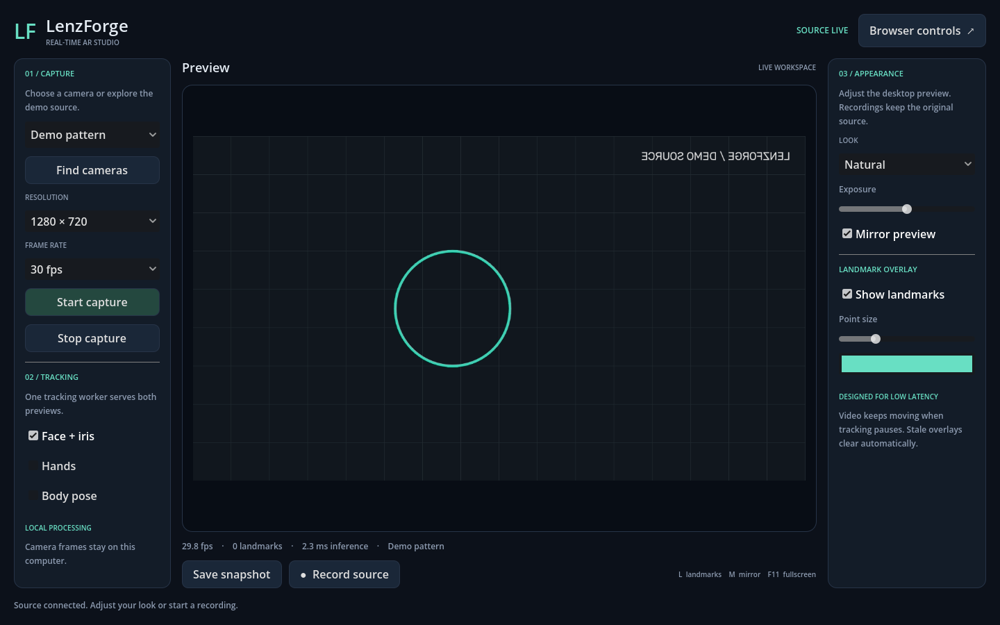

# LenzForge Studio

A local Windows camera and AR workspace with a Godot desktop viewer, browser controls, and MediaPipe face, iris, hand, and body tracking. Python owns capture and routes inference to native CPU models or a local browser GPU worker; a C++ GDExtension brings video and face landmarks into Godot through shared memory.



## Start here

Requires Windows 10/11 x64, an internet connection for initial setup, and several GB of free disk space. A webcam is optional: the demo source exercises video, controls, recording, and both previews without opening a camera.

```powershell
git clone https://github.com/saki2fifty/LenzForge.git
cd LenzForge
.\Setup.ps1
```

Setup downloads a project-local Python, Godot, C++ compiler, bindings, and three tracking models. It installs locked Python packages, builds debug and release native extensions, and imports the Godot project for its first launch. No system Python or compiler installation is required. The initial build can take several minutes. Re-running setup reuses downloaded tools and incremental builds.

In one PowerShell terminal:

```powershell
.\Start-Backend.ps1
# Or start with the synthetic source already running:
.\Start-Backend.ps1 -Demo
```

In another terminal:

```powershell
.\Start-Viewer.ps1
```

Browser controls are at **http://127.0.0.1:5000**. Both interfaces automatically list cameras by their Windows device names. Choose your physical webcam, then select **Start capture**. **Demo pattern (no camera)** generates a test animation; virtual cameras need their own source application running. **Find cameras** refreshes the list without interrupting capture. Close the backend with Ctrl+C. Use `Start-Viewer.ps1 -Editor` to edit the Godot project.

Capture defaults to 1280×720 at 60 fps; cameras may negotiate a lower supported rate. The desktop reports preview and capture rates separately. Native NV12 cameras avoid full-resolution RGB conversion for desktop video; other formats use the BGR fallback.

The desktop viewer expects port 5000. `Start-Backend.ps1 -Port 5001` is available for browser-only development; change `BACKEND` in `viewer/studio.gd` if using a different desktop port.

## What works

- One background capture owner and one tracking publisher, shared by both interfaces. GPU tracking starts its own hidden local browser; no browser window needs to be opened manually.
- [CPU/GPU tracking](docs/GPU_TRACKING.md) with automatic timing-based selection and CPU fallback. The compact **Tracking** tab exposes live resolution, face count, confidence, and output settings. CPU keeps tracking during GPU startup and calibration.
- [Automatic settings](docs/SETTINGS.md): camera choices, MediaPipe and selected models, appearance, landmarks, hair physics, mannequin controls, and browser effects restore after restarting. Changes save as you edit; pending backend edits survive disconnection.
- Quick-access icons above the center preview toggle all landmark guides, camera head occlusion, hair, mirror, and the 3D mannequin. The processor menu selects Auto/GPU/CPU; the Models menu switches face/hand/pose models or opens downloads. Controls stay synchronized with the side panels and autosave.
- [Model library and head visibility](docs/MODELS_AND_VISIBILITY.md): download/select official Face, Hand, and Pose Lite/Full/Heavy bundles, import compatible custom `.task` models, and hide live landmarks/strands behind the fitted head. **Hair → Roots** controls the pink generated-root guides.
- Face tracking with 478 landmarks, 52 blendshape scores, and a face transform; optional hand and body tracking. Hand/body results appear in the browser and JSON exports. The desktop overlay currently displays face/iris points.
- GPU NV12 color conversion, mirror, four desktop looks, exposure, and customizable landmark points. Video continues when tracking cannot detect a face; stale overlays disappear.
- Independent [virtual landmarks](docs/LANDMARKS.md) around the entire face outline: extend above the head, below the chin, to either side, and forward/backward. A dedicated **Landmarks** tab controls orange reference points with hair on or off.
- A [hair and beard editor](docs/BEARD.md): a virtual head grid extending over the crown, under the chin, and around the sides, with roots attached between its points. Existing face landmark depth drives its response to head turns. Separate mustache/eyebrow controls and Regular, Mohawk, and Afro presets support density, length, taper, curl, colors, forces, and static/styled/free motion. Save complete looks with thumbnails or exchange individual curves with Blender.
- Responsive dark studio interfaces, measured frame/inference statistics, source controls, and a camera-free demo.
- Browser preview effects and JPEG quality control. Preview effects are independent between the desktop and browser.
- Source recording to playable MJPEG AVI with timestamped landmark JSONL in `recordings/`. Recording memory stays bounded; files grow with recording duration.
- Browser source-image and landmark exports. Desktop snapshots capture the complete studio window in Godot's `user://captures` directory; the UI reports the full saved path.
- Persistent desktop look, mirror, landmark visibility, and working beard. Shortcuts: **L** landmarks, **M** mirror, **F11** fullscreen.

**Recordings keep the original camera source**, without preview looks, mirror, or overlays. Virtual-camera output is not connected end to end; the earlier GOD1 writer is retained as a foundation. Background segmentation and face-specific effects remain experimental and are withheld from the new browser effect picker.

Open the desktop **Landmarks** tab for general face/head extensions. Orange points are enabled by default: 72 points around the outline × 4 outward layers = 288 virtual landmarks, adjustable up to 1,728. Under **Regional contour**, choose **Forehead**, either side, or **Chin** to set its starting position, outward reach, backward reach, and wrap angle. **Round this region** curves its rows around the head. **Move up / down** still moves the whole set. These references use the existing tracked face and work with hair disabled; their settings persist independently of hairstyles. Enable **Try on mannequin** to preview without a camera, or start capture with **Face + iris**. See the [landmark guide](docs/LANDMARKS.md).

Open **Hair** to edit beard, roots, mustache, eyebrows, scalp hair, physics, individual strands, and the library. **Root surface → Extend root coverage** fits the separate surface used for hair attachment, preserving existing saved looks. **Try on mannequin** now opens a shaded 3D head with depth-tested landmarks and hair. Drag to rotate, scroll to zoom, or use **Front / Side / Back / Reset view**. Hair retains the fast planar physics solver; the live camera remains a 2D overlay without full head occlusion. Restart the viewer to load these controls. A native rebuild is only needed when updating an older native extension.

## Toolchain

Stable versions checked on October 15–16, 2026:

| Component | Version |
| --- | --- |
| Godot | 4.7.2 stable |
| godot-cpp | 10.0.0 stable, targeting the 4.7 API |
| Python | 3.15.0 |
| MediaPipe Python / browser | 1.1.1 / 1.1.1, Tasks API |
| WebSocket transport | 17.2 |
| OpenCV contrib | 5.0.0.93 |
| NumPy | 2.5.4 |
| Flask / Waitress | 3.1.3 / 3.0.2 |
| GCC / SCons | 16.2.0 / 4.11.1 |

[`toolchain.json`](toolchain.json) pins native tooling and the browser runtime. [`requirements.txt`](requirements.txt) pins direct runtime dependencies; [`requirements.lock.txt`](requirements.lock.txt) includes all resolved runtime and development packages for Windows x64/Python 3.15. Only one OpenCV wheel is installed. Setup verifies the Godot archive SHA-256 and browser runtime SHA-512 and runs `pip check`. GPU tracking uses an installed Microsoft Edge or Chrome; if unavailable, CPU tracking continues. Existing installations can run `Setup.ps1 -SkipBuild` to add the new GPU dependencies without rebuilding native code.

Release references: [Godot](https://godotengine.org/download/windows/), [godot-cpp](https://github.com/godotengine/godot-cpp/releases), [Python](https://www.python.org/downloads/windows/), [MediaPipe](https://pypi.org/project/mediapipe/), [OpenCV contrib](https://pypi.org/project/opencv-contrib-python/).

## Repository layout

```text
backend/             Capture, Tasks inference, IPC writers, HTTP API, browser studio
viewer/              Active Godot project and C++ GDExtension
tools/               Portable bootstrap and validation tools
tests/               Backend, model, protocol, and recording regression tests
docs/                Current architecture and API notes
docs/archive/        Historical plans and analyses
legacy/              Original setup and superseded backend components
viewer/legacy/       Original Godot scenes/scripts, excluded by .gdignore
```

Run and edit `backend/` and `viewer/` directly. Setup no longer copies sources into a second workspace. Existing local `workspace_v2/` and older tool downloads are left intact, ignored by Git, and unused by the launchers. Generated tools, models, recordings, caches, and binaries are not committed.

## Validation

After setup:

```powershell
.\buildtools\python-3.15.0\python.exe -B tools\check.py
```

This runs Python regression tests, a Godot headless import/startup, native video/landmark probes, beard physics/library/interchange checks, and an isolated integration test that discovers the demo source and presses the viewer's actual **Start capture** button through the HTTP API. The Windows GitHub Actions workflow runs the same checks. Additional rendered beard and real Blender round-trip checks are documented in the [beard guide](docs/BEARD.md).

Local validation also rendered both interfaces and exercised face inference on a public-domain portrait bundled with Matplotlib. On the development PC, a NexiGo N960E at 1280×720 now delivered 60 fps capture, about 60 fps face tracking, and 50.8 distinct preview frames/sec on a 60 Hz display. The previous pipeline displayed 21.7 fps at its 30 fps setting. These short-run observations are not guarantees for other devices or lighting conditions. See the [performance measurements and reproducible benchmark](docs/PERFORMANCE.md), including the comparison at the same 30 fps setting. Other camera models and the full range of retained effects still need hardware/manual coverage.

See [architecture and modernization decisions](docs/ARCHITECTURE.md), [supported API](docs/API.md), [GPU tracking and measurements](docs/GPU_TRACKING.md), and the earlier [MediaPipe capability review](docs/MEDIAPIPE_FACE_LANDMARKER.md). Historical documents describe earlier plans and are not current feature guarantees.

## Troubleshooting

- **Missing native extension or DLL:** rerun `Setup.ps1`. For a code-only rebuild use `Setup.ps1 -SkipInstall`; close running viewers first.
- **Missing model:** rerun setup. Alternatively set `LENZFORGE_MODELS` to a directory containing the three `.task` files listed in `tools/bootstrap.py`.
- **Camera unavailable:** close other applications using it, verify Windows camera permissions, and try Demo pattern to separate capture issues from viewer issues. Hardware may negotiate a different resolution or frame rate.
- **Only a pattern or virtual-camera screen appears:** choose your physical webcam by its device name and click **Start capture**. The demo and virtual devices are separate sources. If discovery reports a missing helper after an update, run `Setup.ps1 -SkipInstall` once.
- **Backend offline:** keep its terminal open and verify port 5000 is available. The service binds to loopback by default.
- **Slow tracking:** use **Tracking → Auto** and compare its reported CPU/GPU times. Lower tracking image width without restarting capture. The mailbox replaces old work rather than accumulating latency.
- **GPU fallback:** the Tracking tab reports the active backend and reason. Run `Setup.ps1 -SkipBuild` if assets are missing; install Edge/Chrome if no browser is available. Apply settings again to retry GPU initialization.

## License

Project source is MIT licensed; see [LICENSE](LICENSE). Downloaded engines, packages, compilers, and models retain their upstream licenses. Model and inference dependencies are downloaded only during setup, and camera frames are processed locally.
