<p align="center">
  <a href="https://godotengine.org/">
    <picture>
      <source media="(prefers-color-scheme: dark)" srcset="docs/images/godot-logo-dark.svg">
      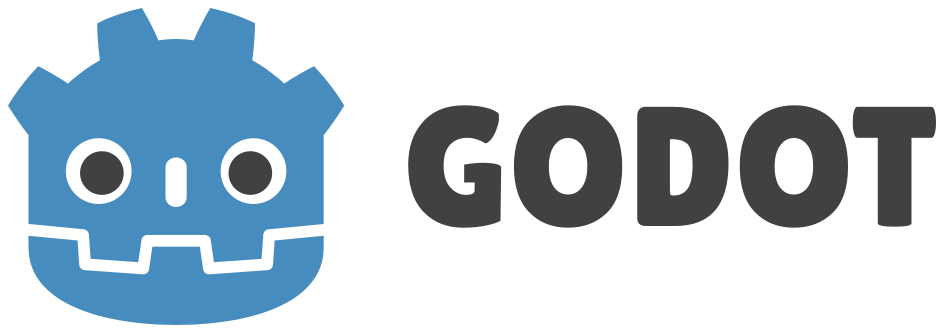
    </picture>
  </a>
  <br>
  <strong>Based on Godot Engine</strong>
</p>

[](CHANGELOG.md)

# LenzForge Studio

**Physics-based facial hair. Live AR in Godot. A demonstrated 60 FPS.**

I built this locally a couple of years ago, and just revisited to update certain features as well as a bit of modernization.

Build a look with beards and mustaches that react to gravity, wind, and head movement; sculpted 3D hairstyles; and background and facial effects. Shape facial strands on a rotatable mannequin, then send your composed camera feed to apps such as Discord.

**Watch the live demo** · 8.9 seconds · 60 FPS

https://github.com/user-attachments/assets/00009745-ddd4-42e6-9e0e-8dbcb155b7cd

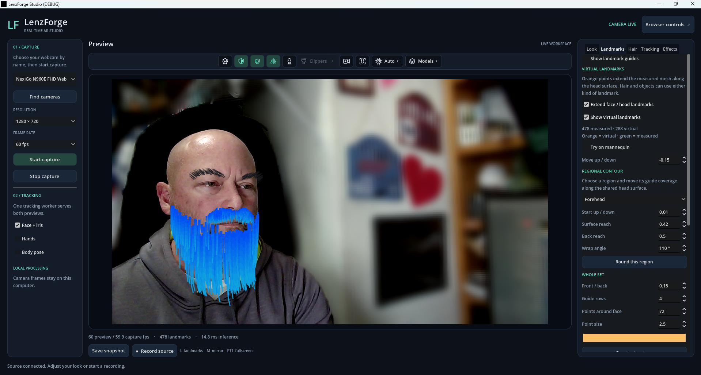

*Live webcam capture with AR facial hair and background blur. A separate 20-second benchmark with CPU face tracking, 1,024 facial strands × 8 segments, facial effects, and background blur measured 59.93 preview fps on the development PC. See [performance measurements and hardware](docs/PERFORMANCE.md#facial-effects); results depend on the camera, hardware, and settings.*

[Get started](#start-here) · [Feature tour](#feature-tour) · [Settings tabs](#settings-tabs) · [Virtual camera](#virtual-camera-in-discord) · [Performance](docs/PERFORMANCE.md)

LenzForge is a local Windows camera and AR workspace with a Godot desktop viewer, browser controls, and MediaPipe face, iris, hand, and body tracking. Python owns capture and routes inference to native CPU models or a local browser GPU worker; a C++ GDExtension brings video and face landmarks into Godot through shared memory and accelerates strand physics.

## Start here

Requires Windows 10/11 x64, an internet connection for initial setup, and several GB of free disk space. A webcam is optional: the demo source exercises video, controls, recording, and both previews without opening a camera.

```powershell
git clone https://github.com/saki2fifty/LenzForge.git
cd LenzForge
.\Setup.ps1
```

Setup downloads a project-local Python, Godot, C++ compiler, bindings, and three tracking models. It installs locked Python packages, builds debug and release native extensions, and imports the Godot project for its first launch. No system Python or compiler installation is required. The initial build can take several minutes. Re-running setup reuses downloaded tools and incremental builds.

In one PowerShell terminal:

```powershell
.\Start-Backend.ps1
# Or start with the synthetic source already running:
.\Start-Backend.ps1 -Demo
```

In another terminal:

```powershell
.\Start-Viewer.ps1
```

Browser controls are at **http://127.0.0.1:5000**. Both interfaces automatically list cameras by their Windows device names. Choose your physical webcam, then select **Start capture**. **Demo pattern (no camera)** generates a test animation; virtual cameras need their own source application running. **Find cameras** refreshes the list without interrupting capture. Close the backend with Ctrl+C. Use `Start-Viewer.ps1 -Editor` to edit the Godot project.

Capture defaults to 1280×720 at 60 fps; cameras may negotiate a lower supported rate. The desktop reports preview and capture rates separately. Native NV12 cameras avoid full-resolution RGB conversion for desktop video; other formats use the BGR fallback.

The desktop viewer expects port 5000. `Start-Backend.ps1 -Port 5001` is available for browser-only development; change `BACKEND` in `viewer/studio.gd` if using a different desktop port.

### Edit the layout in Godot

Import `viewer/project.godot`, open `studio.tscn` from the FileSystem dock, and select **2D**. The saved scene contains the studio layout, toolbar, and all five settings tabs. Expand **LenzForgeStudio → Layout → Studio** to edit controls in the Inspector. If the scene was already open before updating, reload it from disk. See the [Godot editing guide](docs/EDITOR.md) for panel sizing, hidden pages, and runtime settings.

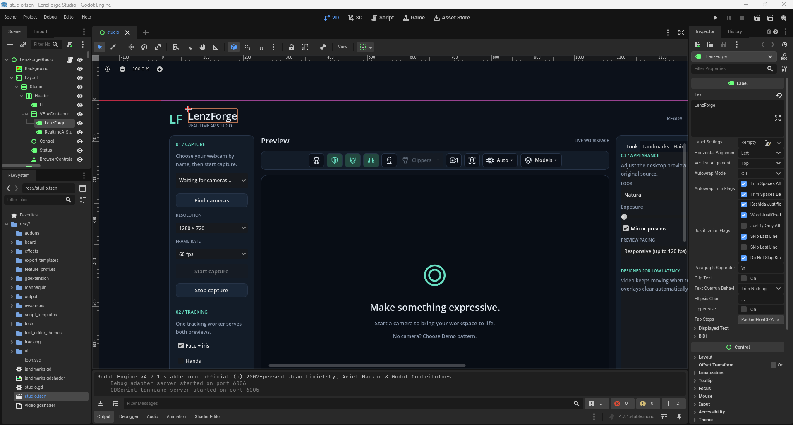

*Edit the studio visually in Godot: select controls in the scene tree, then adjust text, styling, and layout in the Inspector.*

## Feature tour

### 3D mannequin and physics-based grooming

Inspect your look from any angle: drag to rotate, scroll to zoom, or jump to **Front**, **Side**, and **Back**. The same facial strands appear on the mannequin and your tracked face.

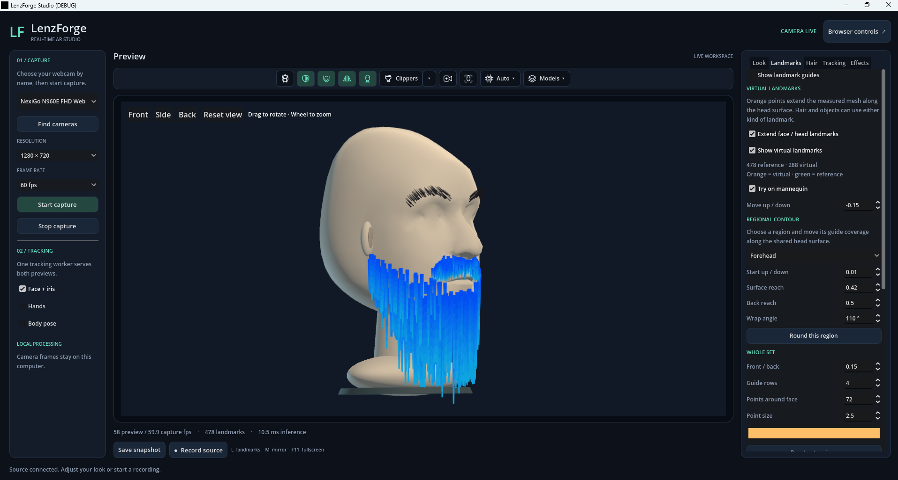

Beard and mustache strands use native 3D physics inside Godot, with adjustable gravity, wind, damping, curl, length, and taper. Head collisions keep strands outside the fitted surface; depth and occlusion hide covered strands. Mustache physics can be tuned independently, while facial hair supports static, styled, or free motion. Scalp hairstyles are fitted 3D mesh objects. See the [hair and beard guide](docs/BEARD.md).

### Clippers: cut, watch it fall, keep the style

Enable the mannequin, then choose **Line** or **Buzz** from the **Clippers** dropdown. Line cuts along a drag; Buzz runs while you hold left click and trims visible facial strands on contact. Choose a small, medium, or large buzz blade.

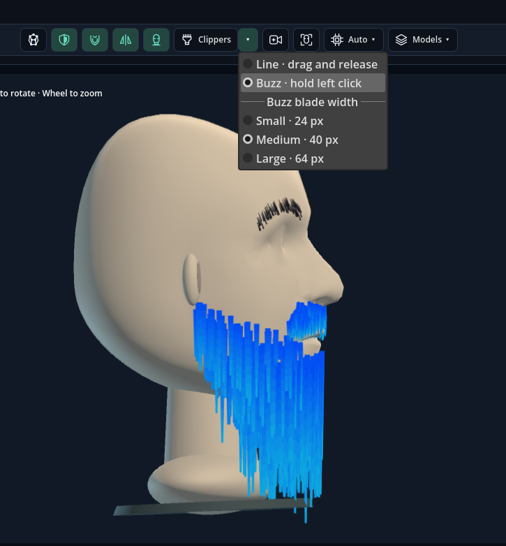

Cut ends detach, fall under physics, and clean themselves up. Each remaining strand keeps its own new length and original segment count. Cuts save automatically, and **Undo cut / Ctrl+Z** restores a stroke. Clippers currently trim facial strands; sculpted scalp meshes have separate shape controls.

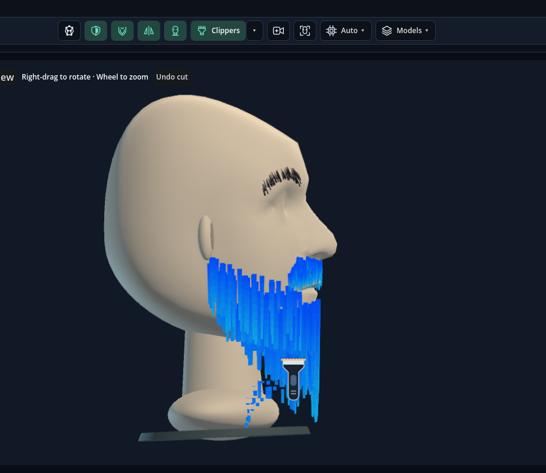

### Settings tabs

All five tabs save changes automatically and restore them at the next launch. Expand a tab below to see its controls. These screenshots show an active setup; values are personal choices, not necessarily the shipped defaults.

<details>
<summary><strong>Look</strong> — appearance and preview pacing</summary>

Choose a look, adjust exposure, mirror the preview, and select responsive, display-synchronized, or lower-power pacing.

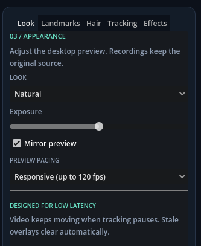

</details>

<details>
<summary><strong>Landmarks</strong> — extend and fit the head surface</summary>

Use measured face points and virtual landmarks as attachment references. Adjust the forehead, sides, and chin, control guide density and color, and inspect the fit on the mannequin. See the [landmark guide](docs/LANDMARKS.md).

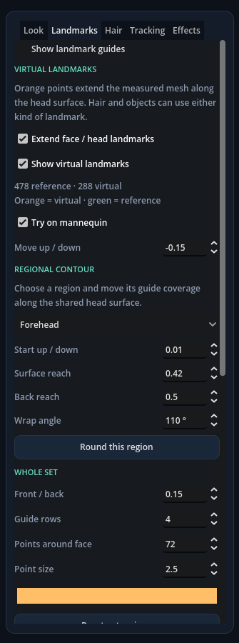

</details>

<details>
<summary><strong>Hair</strong> — beard, mustache, eyebrows, and scalp styles</summary>

Edit coverage, length, width, taper, colors, and motion. The screenshot shows eyebrow controls; the same tab provides separate beard, mustache, scalp, physics, strand, and library pages.

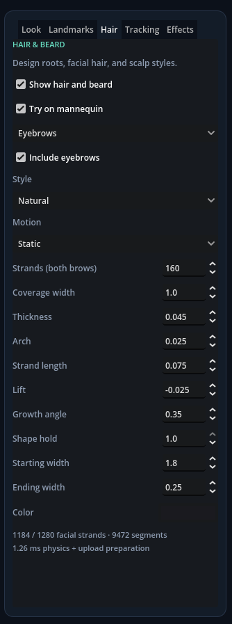

</details>

<details>
<summary><strong>Tracking</strong> — MediaPipe, CPU/GPU, and models</summary>

Choose Auto, CPU, or browser GPU tracking; adjust tracking resolution and confidence; and select, download, or import compatible models. Live timings help compare backends. See [tracking](docs/GPU_TRACKING.md) and the [model library](docs/MODELS_AND_VISIBILITY.md).

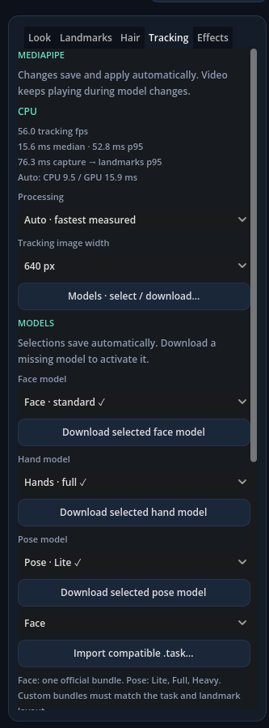

</details>

<details>
<summary><strong>Effects</strong> — background blur, skin, and color</summary>

Adjust background blur, person confidence, edge inset and softness, and mask update rate. **Reduce background leaks** applies a cleanup preset; **Learn empty room** helps reject stubborn background patches. Other groups provide skin smoothing, facial brightness/warmth, blush, lip tint, and color adjustments. See the [effects guide](docs/EFFECTS.md).

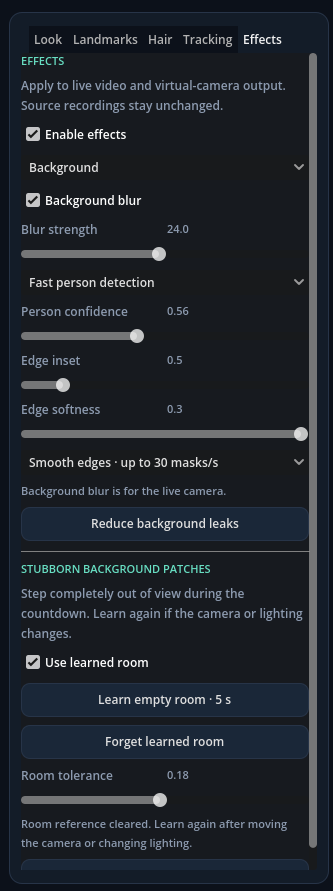

</details>

### Virtual camera in Discord

After the [one-time Windows 11 camera setup](docs/VIRTUAL_CAMERA.md#one-time-setup), click the **virtual-camera icon** above the preview to publish the composed stream. Your AR facial hair, background blur, and other preview effects travel with it; the studio controls stay in LenzForge.

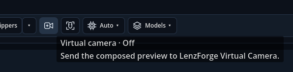

In Discord's camera settings, select **LenzForge (Windows Virtual Camera)**. The screenshot below shows the live result inside Discord. Other apps can select the same device when they support Windows virtual cameras. Output offers 720p at 30 or 60 fps; the receiving app controls its selected format and delivery rate.

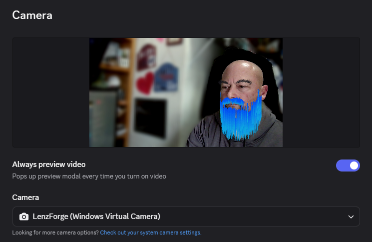

## What works

- One background capture owner and one tracking publisher, shared by both interfaces. GPU tracking starts its own hidden local browser; no browser window needs to be opened manually.
- [CPU/GPU tracking](docs/GPU_TRACKING.md) with automatic timing-based selection and CPU fallback. The compact **Tracking** tab exposes live resolution, face count, confidence, and output settings. CPU keeps tracking during GPU startup and calibration.
- [Automatic settings](docs/SETTINGS.md): camera choices, MediaPipe and selected models, appearance, landmarks, hair physics, mannequin controls, and browser effects restore after restarting. Changes save as you edit; pending backend edits survive disconnection.
- [Effects tab](docs/EFFECTS.md): GPU skin smoothing with protected facial features, face brightness/warmth, cheek blush and lip tint using existing landmarks. Also includes background blur with learned-room cleanup, plus global color filters and adjustments. Grouped controls autosave; effects appear in the live preview and virtual-camera output. Facial effects need no additional AI model; background segmentation runs only while blur is in use.
- Quick-access icons above the center preview toggle all landmark guides, camera head occlusion, hair, mirror, and the 3D mannequin. The processor menu selects Auto/GPU/CPU; the Models menu switches face/hand/pose models or opens downloads. Controls stay synchronized with the side panels and autosave.
- [Clippers](docs/BEARD.md#clippers): in the 3D mannequin, choose Line or Buzz from the dropdown. Drag a cutting line, or hold left click to run electric clippers that cut on contact. Retained strands keep their segment count; detached ends fall and clean themselves up. Cuts autosave, with Undo cut / Ctrl+Z for each stroke. Clippers trim facial strands. **Hair → Scalp hair** offers sculpted **Side-swept, Center-parted and Long layered** meshes alongside generated Regular, Mohawk and Afro objects. All fit around the head with shape/color controls and no scalp strand simulation.
- [Guided head calibration](docs/CALIBRATION.md): the toolbar's head icon walks through multiple poses, with optional hair/beard reveal steps, detected-hand exclusion, outline review and manual corrections. Saves a personal fit for virtual landmarks, attachments, occlusion and collisions; hidden regions remain estimates.
- [Native virtual camera](docs/VIRTUAL_CAMERA.md): the top-toolbar camera button sends the composed preview, including hair and effects, to **LenzForge Windows Virtual Camera**. Offers 720p at 30/60 fps using a C++ Media Foundation source. Requires Windows 11 and one-time component installation; see the setup guide for the additional Windows SDK build requirement.
- Virtual-camera output uses shared GPU textures and GPU NV12 conversion when supported, with the original CPU transport as fallback. Tracking and hair simulation still run once. The camera tooltip reports the active transfer path.
- [Model library and head visibility](docs/MODELS_AND_VISIBILITY.md): download/select official Face, Hand, and Pose Lite/Full/Heavy bundles, import compatible custom `.task` models, and hide live landmarks/strands behind the fitted head. **Hair → Roots** controls the pink generated-root guides.
- Face tracking with 478 landmarks, 52 blendshape scores, and a face transform; optional hand and body tracking. Hand/body results appear in the browser and JSON exports. The desktop overlay currently displays face/iris points.
- GPU NV12 color conversion, mirror, four desktop looks, exposure, and customizable landmark points. Video continues when tracking cannot detect a face; stale overlays disappear.
- Independent [virtual landmarks](docs/LANDMARKS.md) around the entire face outline: extend above the head, below the chin, to either side, and forward/backward. A dedicated **Landmarks** tab controls orange reference points with hair on or off.
- A [hair and beard editor](docs/BEARD.md): one shared head surface for measured/virtual attachments over the crown, under the chin, and around the sides. Existing face landmark depth drives its response to head turns. Separate mustache/eyebrow controls and Regular, Mohawk, and Afro presets support density, length, taper, curl, colors, forces, and static/styled/free motion. Save complete looks with thumbnails or exchange individual curves with Blender.
- Fuller beard coverage uses lower virtual roots by default, wrapping under the jaw and around both sides without increasing strand count. Any hair region can attach to measured or virtual landmarks. Mustache gravity, wind, damping, collision, and length variation are independent; edit them on **Hair → Mustache**.
- Responsive dark studio interfaces, measured frame/inference statistics, source controls, and a camera-free demo.
- Browser preview effects and JPEG quality control. Preview effects are independent between the desktop and browser.
- Source recording to playable MJPEG AVI with timestamped landmark JSONL in `recordings/`. Recording memory stays bounded; files grow with recording duration.
- Browser source-image and landmark exports. Desktop snapshots capture the complete studio window in Godot's `user://captures` directory; the UI reports the full saved path.
- Persistent desktop look, mirror, landmark visibility, and working beard. Shortcuts: **L** landmarks, **M** mirror, **F11** fullscreen.

**Recordings keep the original camera source**, without preview looks, mirror, or overlays. The virtual camera sends the composed desktop preview, including desktop effects. Background blur is available in the desktop **Effects** tab; the browser effect picker remains independent.

Open the desktop **Landmarks** tab for general face/head extensions. The default layout has 72 points around the outline × 4 guide rows = 288 virtual landmarks, adjustable up to 1,728. Landmark guides and generated-root dots are hidden by default; enable **Show landmark guides** to inspect the reference points. Under **Regional contour**, choose **Forehead**, either side, or **Chin** to set its starting position, outward reach, backward reach, and wrap angle. **Round this region** curves its rows around the head. **Move up / down** still moves the whole set. These references use the existing tracked face and work with hair disabled; their settings persist independently of hairstyles. Enable **Try on mannequin** to preview without a camera, or start capture with **Face + iris**. See the [landmark guide](docs/LANDMARKS.md).

Open **Hair** to edit beard, roots, mustache, eyebrows, scalp hair, physics, individual strands, and the library. **Show hair and beard** defaults to enabled, with a **Chevron** mustache using **Styled** motion; saved preferences take precedence. **Root surface → Extend root coverage** distributes roots over the shared head surface. **Strands → Attach root to landmark** supports measured and virtual locations. **Try on mannequin** opens a shaded 3D head with depth-tested landmarks and hair. Drag to rotate, scroll to zoom, or use **Front / Side / Back / Reset view**. Native 3D strand physics collides with the shared head surface, including between joints, independently of guide visibility or visual occlusion. Live scalp/back geometry remains estimated. Restart the viewer after an update; rebuild with `Setup.ps1 -SkipInstall` when the native extension changes.

## Toolchain

Stable versions checked on October 15–16, 2026:

| Component | Version |
| --- | --- |
| Godot | 4.7.2 stable |
| godot-cpp | 10.0.0 stable, targeting the 4.7 API |
| Python | 3.15.0 |
| MediaPipe Python / browser | 1.1.1 / 1.1.1, Tasks API |
| WebSocket transport | 17.2 |
| OpenCV contrib | 5.0.0.93 |
| NumPy | 2.5.4 |
| Flask / Waitress | 3.1.3 / 3.0.2 |
| GCC / SCons | 16.2.0 / 4.11.1 |

[`toolchain.json`](toolchain.json) pins native tooling and the browser runtime. [`requirements.txt`](requirements.txt) pins direct runtime dependencies; [`requirements.lock.txt`](requirements.lock.txt) includes all resolved runtime and development packages for Windows x64/Python 3.15. Only one OpenCV wheel is installed. Setup verifies the Godot archive SHA-256 and browser runtime SHA-512 and runs `pip check`. GPU tracking uses an installed Microsoft Edge or Chrome; if unavailable, CPU tracking continues. Existing installations can run `Setup.ps1 -SkipBuild` to add the new GPU dependencies without rebuilding native code.

Release references: [Godot](https://godotengine.org/download/windows/), [godot-cpp](https://github.com/godotengine/godot-cpp/releases), [Python](https://www.python.org/downloads/windows/), [MediaPipe](https://pypi.org/project/mediapipe/), [OpenCV contrib](https://pypi.org/project/opencv-contrib-python/).

## Repository layout

```text
backend/             Capture, Tasks inference, IPC writers, HTTP API, browser studio
viewer/              Active Godot project and C++ GDExtension
tools/               Portable bootstrap and validation tools
tests/               Backend, model, protocol, and recording regression tests
docs/                Current architecture and API notes
docs/changelog/      Timestamped daily change tables, indexed by CHANGELOG.md
docs/archive/        Historical plans and analyses
legacy/              Original setup and superseded backend components
viewer/legacy/       Original Godot scenes/scripts, excluded by .gdignore
```

Run and edit `backend/` and `viewer/` directly. Setup no longer copies sources into a second workspace. Existing local `workspace_v2/` and older tool downloads are left intact, ignored by Git, and unused by the launchers. Generated tools, models, recordings, caches, and binaries are not committed.

## Validation

After setup:

```powershell
.\buildtools\python-3.15.0\python.exe -B tools\check.py
```

This runs Python regression tests, a Godot headless import/startup, native video/landmark probes, beard physics/library/interchange checks, and an isolated integration test that discovers the demo source and presses the viewer's actual **Start capture** button through the HTTP API. The Windows GitHub Actions workflow runs the same checks. Additional rendered beard and real Blender round-trip checks are documented in the [beard guide](docs/BEARD.md).

The latest performance fix removes a reproduced 30 fps VSync ceiling and parallelizes strand simulation in C++. With a synthetic 60 fps portrait, CPU face tracking, and 1,024 strands × 8 segments with full head collision, distinct preview throughput improved from 22.5 to about 60 fps. Fixed-step simulation time fell from 4.96 to 1.23 ms median on the development PC. **Look → Preview pacing** defaults to a bounded, responsive mode; display synchronization and a lower-power mode remain available. See the [measurements, limits, and reproducible benchmark](docs/PERFORMANCE.md), including earlier physical-camera results. These short runs are not guarantees for other devices or lighting conditions; other cameras and the full range of retained effects still need hardware/manual coverage.

Face attachments now use the exact camera frame that produced their landmarks, keeping video, guides and hair roots aligned during movement. Preview throughput follows completed tracking: the current synthetic comparison retained about 60 matched fps on CPU and 48 on GPU, with zero video/landmark timestamp mismatches. Auto selects the faster measured backend. See the [synchronization results and latency tradeoff](docs/PERFORMANCE.md#matched-attachments-and-beard-boundary).

See [architecture and modernization decisions](docs/ARCHITECTURE.md), [supported API](docs/API.md), [GPU tracking and measurements](docs/GPU_TRACKING.md), and the earlier [MediaPipe capability review](docs/MEDIAPIPE_FACE_LANDMARKER.md). Historical documents describe earlier plans and are not current feature guarantees.

## Troubleshooting

- **Missing native extension or DLL:** rerun `Setup.ps1`. For a code-only rebuild use `Setup.ps1 -SkipInstall`; close running viewers first.
- **Missing model:** rerun setup. Alternatively set `LENZFORGE_MODELS` to a directory containing the three `.task` files listed in `tools/bootstrap.py`.
- **Camera unavailable:** close other applications using it, verify Windows camera permissions, and try Demo pattern to separate capture issues from viewer issues. Hardware may negotiate a different resolution or frame rate.
- **Only a pattern or virtual-camera screen appears:** choose your physical webcam by its device name and click **Start capture**. The demo and virtual devices are separate sources. If discovery reports a missing helper after an update, run `Setup.ps1 -SkipInstall` once.
- **Backend offline:** keep its terminal open and verify port 5000 is available. The service binds to loopback by default.
- **Slow tracking:** use **Tracking → Auto** and compare its reported CPU/GPU times. Lower tracking image width without restarting capture. The mailbox replaces old work rather than accumulating latency.
- **GPU fallback:** the Tracking tab reports the active backend and reason. Run `Setup.ps1 -SkipBuild` if assets are missing; install Edge/Chrome if no browser is available. Apply settings again to retry GPU initialization.

## License

Project source is MIT licensed; see [LICENSE](LICENSE). Downloaded engines, packages, compilers, and models retain their upstream licenses. Model and inference dependencies are downloaded only during setup, and camera frames are processed locally.

### Godot attribution

LenzForge uses [Godot Engine](https://godotengine.org/), available under the [MIT license](https://godotengine.org/license/). Copyright © 2014–present Godot Engine contributors; copyright © 2007–2014 Juan Linietsky and Ariel Manzur.

Godot Engine logo © 2017 Andrea Calabró, licensed under [Creative Commons Attribution 4.0 International (CC BY 4.0)](https://creativecommons.org/licenses/by/4.0/). The light- and dark-background SVG variants come from the [official Godot press kit](https://godotengine.org/press/) and are reproduced unmodified. The [original logo license notice](docs/images/godot-logo-LICENSE.txt) accompanies the images.
