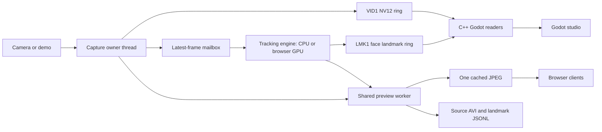

# Architecture and modernization

## Project assessment

The original project combined Python capture/MediaPipe, a Flask UI, Windows named shared-memory rings, and a Godot GDExtension. It contained useful effect and IPC work, but also duplicate deployment trees, Python 3.11-specific capture binaries, Godot 4.3 bindings, legacy `mp.solutions` calls, and controls that returned success without performing an operation. The older README's virtual-camera and 60 fps claims were broader than the implemented/tested behavior.

The active application is now a Windows desktop/browser studio. Historical sources remain available under `legacy/`, `viewer/legacy/`, and `docs/archive/`.

## Data flow

Capture owns camera open/read/release on one thread. Frames are immutable after publication. A single-slot inference mailbox replaces queued work with the latest frame when inference falls behind. Browser connections do not trigger more model instances or more capture reads. JPEG encoding occurs only when browser viewers are connected; source exports and recording continue without them.

The tracking engine supports native Python CPU inference and an isolated browser GPU worker. The installed Windows Python wheel still lacks GPU graph support; the GPU path instead uses the official JS/WASM runtime. Auto mode keeps CPU tracking live during browser initialization and a bounded calibration, then selects GPU only when its measured round trip is at least 5% faster. Explicit GPU and CPU modes are also available. GPU failure returns to CPU; the API exposes the actual backend and fallback reason. See [GPU tracking](GPU_TRACKING.md).

The GPU bridge serves pinned local assets and exchanges uncompressed RGBA frames and binary float32 landmarks over an authenticated loopback WebSocket, with compression disabled. There is one request in flight; capture continues replacing the latest-frame mailbox while inference runs. GPU calibration temporarily runs alongside CPU tracking but only the selected production result publishes to LMK1. CPU remains initialized for fast fallback. Model changes replace the engine on the tracking thread and retire the previous engine in the background; they do not reopen the camera or stop video display.

MSMF devices that supply tightly packed NV12 publish their original planes directly into VID1. Tracking downsizes the Y/UV planes before converting the smaller image to RGB. Full-resolution BGR conversion is lazy and shared by exports, browser preview, and recording only when needed. Unsupported native formats/layouts fall back to BGR and reusable NV12 conversion buffers. Physical reads provide capture pacing; an additional software delay is unnecessary. Only the synthetic source uses deadline pacing.

Both rings use the same capture timestamp in Windows QPC ticks. Readers convert that timestamp to microseconds. Video displays immediately, and overlays older than 150 ms are discarded. Each capture session has unique mapping names returned by `/api/status`, allowing readers to reconnect after a resolution change even while other viewers retain an old mapping.

## Solutions adopted

| Earlier approach | Current implementation and reason |
| --- | --- |
| Python-version-specific MSMF extension | OpenCV's maintained MSMF capture backend removes an extra Python ABI rebuild requirement. Hardware-specific native capture remains an option if profiling justifies it. |
| Opening generic camera indices to discover devices | A small, standalone Media Foundation helper lists friendly names and device identities without activating cameras. Both interfaces refresh safely during capture and keep the selected device identity. |
| MediaPipe legacy Solutions | Tasks face/hand/pose models, explicitly downloaded during setup. Face blendshapes and transformation matrices are available to future avatar features. |
| Capture/inference inside client work | Independent capture and one inference worker with a bounded mailbox reduce duplicated CPU work and accumulated delay. |
| Landmark loop in every shader fragment, then separate circle draws | One instanced quad batch draws all face points with an antialiased circle shader; the video shader only converts and grades pixels. |
| Forward+ for a 2D preview | Godot Compatibility rendering avoids unnecessary 3D renderer overhead and supports more GPUs. |
| Mismatched packed protocol layouts | Explicit 64-byte headers, native static assertions, sequence publication, memory barriers, and copied/rechecked reader snapshots. Native tests verify actual interoperability. |
| Per-frame mapping flush | A tiny Windows atomic publication helper commits aligned sequence fields after payload writes. Disk-style flushes are unnecessary for anonymous shared memory. |
| Two editable source trees | One canonical backend and viewer; versioned project-local tools and incremental builds. |
| Recording/configuration success stubs | Real source recording, measured statistics, and validated runtime model configuration/reset with revision reporting. |

This is a copy-bounded shared-memory pipeline, not a fully zero-copy GPU pipeline: conversion, protected reader snapshots, and texture upload still copy data. The copies make ownership and consistency explicit. Profile real camera workloads before replacing them with a more complex D3D shared-texture implementation.

The video reader copies directly into packed upload planes, reuses image/texture objects, and checks that the copied slot remains valid. A newer publication in another slot does not invalidate that snapshot. Godot uses VSync without a competing software 60 fps cap. Preview FPS counts newly uploaded video frames, separately from capture rate and renderer FPS.

## State and output

- Tracking toggles apply to the shared worker and synchronize between desktop and browser.
- Face/iris points cross LMK1. Hands, pose, blendshapes, and transform data are available through the HTTP snapshot and JSON exports; desktop hand/body rendering is future work.
- Desktop looks are GPU preview settings. Browser effects run before JPEG encoding. Neither changes source recordings.
- Recordings are MJPEG AVI plus one timestamped JSONL record per accepted source frame. Constant-rate output can repeat frames to preserve timing when capture skips frames. Audio is not recorded.
- `user://studio.cfg` stores desktop look/mirror/visibility and the working beard document. `user://beards` contains named library documents and mannequin thumbnails. Tracking and browser performance settings last for the backend session and survive capture restarts; inference size changes apply during capture.
- The HTTP service binds to `127.0.0.1`, validates hosts, and rejects cross-origin mutations. It is intended as a local application service.

## Hair and beard simulation and editing

`tracking/head_surface.gd` owns one fixed-topology head: 478 reference slots and 720 closure vertices. Native `HeadSurfaceMath` deforms it from measured face coordinates/relative Z once per tracking update. Measured IDs remain intact. Virtual IDs encode triangle barycentrics, independent of guide density. Nearest-triangle fitting is cached on placement edits; native packed sampling updates all roots/guides. Force and color edits reuse root bindings.

`tracking/face_extensions.gd` converts saved regional coverage settings into bindings on that surface. `extension_layer.gd` draws 288 default orange guides (maximum 1,728) independently of hair. The mannequin mesh, live depth rasterizer, hair and generic `landmark_attachment.gd` object component share the geometry and resolver. `beard/virtual_head.gd` now supplies legacy distribution targets only at configuration time; it is no longer a second rendered surface. Existing look preferences are preserved, with targets constrained to the skin. See [landmark API and coordinate conventions](LANDMARKS.md).

`viewer/beard/beard_profile.gd` owns bounded, versioned settings, deterministic barycentric root bindings, and guide resampling. `groom_regions.gd` generates face-relative chin/jaw/ear extensions, eyebrow coverage, and estimated scalp roots/guides. `beard_layer.gd` converts current face landmarks into unmirrored video-space anchors; a final canvas transform handles the same mirror/letterboxing as video. Generated roots use a separate magenta marker batch; they are not new measurements or inference work. Face loss pauses the solver, and large pose/scale discontinuities reset it. The editor, library, and Blender bridge share version 2 JSON with stable facial, `brow:N`, and `hair:N` IDs; version 1 still loads with the optional new regions disabled.

`BeardSimulator` in the C++ extension stores 3D roots, positions and previous positions in contiguous arrays. Camera coordinates use pixels with +X right, +Y down and +Z away; rest guides use the tracked 3D right/down basis. Fixed 120 Hz integration applies world-down gravity, wind, damping, and optional shape preservation. Only roots follow the face; free points retain momentum, so faster head turns produce larger swings. Root interpolation across substeps keeps the response consistent across display rates. Wind variation is inactive when wind is zero.

Four constraint iterations distribute tension corrections between neighboring free points, followed by a final length/collision pass. Moving only the downstream point produced poor dynamic behavior in the first solver; this asymmetric-mass issue is also discussed in [Fast Simulation of Inextensible Hair and Fur, §3.2](https://matthias-research.github.io/pages/publications/FTLHairFur.pdf). Catch-up is capped at four steps to prevent long stalls from creating a simulation backlog. Configurations are bounded at 1,024 facial strands, 256 eyebrow strands, and 768 scalp strands: 2,048 total, with 2–16 segments each. The solver accepts per-strand motion/hold/collision options. Static regions follow their guides directly and skip force integration while still respecting the head collider; Styled regions retain springs; Free regions hang under world gravity. Existing beard files default to free-hanging motion; their styled guides remain available through **Preserve styled beard shape**.

Live-camera rendering uses one `MultiMeshInstance2D` for all hair regions, with one quad per segment. Each instance has an eight-float 2D transform, four color floats, and four custom floats carrying taper widths. The shader antialiases the tapered edges; the CPU prepares one packed buffer per display frame. Root bindings, generated-marker indices, and rest guides are rebuilt only when settings change. Individual selection highlighting is a separate lightweight overlay used only in edit mode.

`HeadCollider` builds six 64×64 directional bins from the actual shared triangles on tracking updates. A particle queries the small triangle list in one bin to find the solid outer surface; the directional representation conservatively fills non-star-shaped recesses. Short link sweeps walk crossed cells in the same directional grid; a refitted BVH handles sweeps crossing cube-face seams, so two exterior joints cannot bridge through the head. Thick roots are lifted slightly from the skin to avoid pinning the first joint inside its own collision radius. Contact removes normal bounce and damps tangential motion; physics remains independent of visual guide/occlusion toggles. Query loops allocate no memory. The legacy 2D anchor API remains available for existing dynamics probes and uses the lip ellipse when no head is supplied.

This avoids per-hair Godot nodes, rigid bodies, or Python work in the camera path. Estimated live head self-occlusion is implemented. Native head-surface collision is enabled by the saved `collisions` setting for every hair region; hair-to-hair/body collision, scene occlusion and composed-video output remain future work. The [beard guide](BEARD.md) documents controls, persistence, Blender curve exchange, and test commands. The [performance report](PERFORMANCE.md#beard-physics) includes actual webcam runs at default and maximum density.

The offline preview in `viewer/mannequin/` builds a genuine 3D bust lazily: the bundled canonical MediaPipe face retains landmark indices, and procedural geometry closes the skull and adds ears, eyes, neck, and a stand. An orthographic camera projects the 478 reference points and the same shared surface bindings used for live fitting. Geometry and points rotate together through side/rear views without relying on a projected cheek width, which collapses at profile. Two directional lights and ambient light provide shading under the existing Compatibility renderer.

Mannequin roots use the same cached triangle bindings as live roots. The same head mesh supplies measured and virtual attachment positions, so neither kind floats off the skin. Camera-space 3D roots feed the native solver. A `MultiMeshInstance3D` shader reads its packed output from an RGBAF texture, reconstructs segment quads with the simulated endpoint depths, and depth-tests against the solid bust. There is no per-segment GDScript transform conversion or simultaneous 2D hair upload. Texture layout is 256 pixels wide, at most 512 rows for 32,768 segments. The live 2D batch uses the same endpoint depths for fragment occlusion. Spare custom-data Z/W components carry depth without increasing the 16-float segment buffer or allocating a separate depth texture. Blender guide exports carry surface root depths, not the transient simulated pose.

The mannequin viewport renders at the fitted preview resolution, capped at 720p; thumbnails use their own small resolution. Pose and fitting changes request one frame, hair requests frames while active, and leaving mannequin mode disables the viewport. With hair off, no continual renderer or simulation work is requested for a stationary head. Camera frames can continue arriving without changing mannequin projection dimensions. Existing persisted grooming and extension settings are preserved.

## Verification and limits

Validation covers wire layout/publication, NV12 color round trips, latest-frame behavior, capture without viewers and restart generations, recording decode, API behavior, invalid configuration atomicity, and Tasks inference. A public-domain Grace Hopper portrait from Matplotlib's sample data produces 478 face landmarks, 52 blendshapes, and a 4×4 transform. An isolated Python producer also exercises the compiled Godot readers with known values, timestamps, and face-loss events.

Godot debug and release extensions build against the 4.7 API. Headless import/startup passes. Native screenshots were inspected at 1440×900 and 1024×720; the browser was checked at desktop size. Development graphics hardware: Radeon RX 7900 XTX. The synthetic 1280×720 demo measured about 29.7 fps with a 30 fps target; blank-scene inference was about 2.6 ms. These are smoke-test observations, not a controlled comparative benchmark.

The headless import check gives deferred editor callbacks time to finish before shutdown. An immediate exit on a fresh project reproduced the upstream [GDExtension documentation shutdown race](https://github.com/godotengine/godot/issues/111048). Validation still fails on nonzero exits and engine/script errors; the workaround does not ignore failures.

Hardware profiling confirmed a NexiGo N960E FHD Webcam at 1280×720 and 60 fps, with about 60 fps face inference and 478 landmarks reaching Godot. Displayed video improved from 21.7 fps to 50.8 fps after pacing, color conversion, upload, and overlay changes; a same-setting 30 fps comparison and measurement limits are in [Performance](PERFORMANCE.md). Discovery completed in about 350 ms while capture continued. Media Foundation GPU transform initialization had stalled on this machine; capture defaults `OPENCV_VIDEOIO_MSMF_ENABLE_HW_TRANSFORMS=0` before OpenCV loads. The pipeline consumes CPU-addressable NV12/BGR frames, so this avoids unnecessary GPU initialization; an explicit environment override is respected. See the [OpenCV MSMF setting](https://docs.opencv.org/5.0/main_modules/videoio_flags_base.html) and [Microsoft device enumeration API](https://learn.microsoft.com/en-us/windows/win32/medfound/enumerating-video-capture-devices).

Other camera models, sustained recording, GPU/driver variation, and all retained effect parameter combinations need further manual coverage. A driver that blocks indefinitely inside a capture call can still require a backend restart; discovery runs in a separate process with a five-second timeout. The old GOD1 writer is preserved but does not constitute a working virtual-camera output path.

## Next improvements

1. Validate multiple real webcams at 720p/1080p and 30/60 fps; record capture, inference, and display latency separately before further optimization.
2. Connect a composed-video output path to OBS/virtual-camera tooling. A user-space OBS integration is a practical first step before maintaining a signed Windows camera driver.
3. Extend desktop overlays and avatar controls with hand/pose data, blendshapes, and the face transform.
4. Add a real segmentation mask before exposing background replacement controls. Keep it on the same bounded worker pipeline.
5. Package a signed Windows release with model/dependency notices and a first-run hardware check after the hardware validation pass.

Upstream references: [Godot GDExtension](https://docs.godotengine.org/en/stable/tutorials/scripting/gdextension/index.html), [godot-cpp releases](https://github.com/godotengine/godot-cpp/releases), and [MediaPipe Face Landmarker](https://developers.google.com/edge/mediapipe/solutions/vision/face_landmarker/python).
