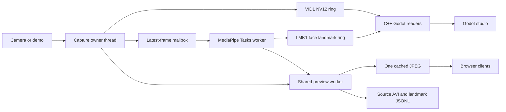

# Architecture and modernization

## Project assessment

The original project combined Python capture/MediaPipe, a Flask UI, Windows named shared-memory rings, and a Godot GDExtension. It contained useful effect and IPC work, but also duplicate deployment trees, Python 3.11-specific capture binaries, Godot 4.3 bindings, legacy `mp.solutions` calls, and controls that returned success without performing an operation. The older README's virtual-camera and 60 fps claims were broader than the implemented/tested behavior.

The active application is now a Windows desktop/browser studio. Historical sources remain available under `legacy/`, `viewer/legacy/`, and `docs/archive/`.

## Data flow

Capture owns camera open/read/release on one thread. Frames are immutable after publication. A single-slot inference mailbox replaces queued work with the latest frame when inference falls behind. Browser connections do not trigger more model instances or more capture reads. JPEG encoding occurs only when browser viewers are connected; source exports and recording continue without them.

Both rings use the same capture timestamp in Windows QPC ticks. Readers convert that timestamp to microseconds. Video displays immediately, and overlays older than 150 ms are discarded. Each capture session has unique mapping names returned by `/api/status`, allowing readers to reconnect after a resolution change even while other viewers retain an old mapping.

## Solutions adopted

| Earlier approach | Current implementation and reason |
| --- | --- |
| Python-version-specific MSMF extension | OpenCV's maintained MSMF capture backend removes an extra Python ABI rebuild requirement. Hardware-specific native capture remains an option if profiling justifies it. |
| MediaPipe legacy Solutions | Tasks face/hand/pose models, explicitly downloaded during setup. Face blendshapes and transformation matrices are available to future avatar features. |
| Capture/inference inside client work | Independent capture and one inference worker with a bounded mailbox reduce duplicated CPU work and accumulated delay. |
| Landmark loop in every shader fragment | Godot draws landmark geometry once per point; the video shader only converts and grades pixels. |
| Forward+ for a 2D preview | Godot Compatibility rendering avoids unnecessary 3D renderer overhead and supports more GPUs. |
| Mismatched packed protocol layouts | Explicit 64-byte headers, native static assertions, sequence publication, memory barriers, and copied/rechecked reader snapshots. Native tests verify actual interoperability. |
| Per-frame mapping flush | A tiny Windows atomic publication helper commits aligned sequence fields after payload writes. Disk-style flushes are unnecessary for anonymous shared memory. |
| Two editable source trees | One canonical backend and viewer; versioned project-local tools and incremental builds. |
| Recording/configuration success stubs | Real source recording, measured statistics, validated controls, and explicit unsupported responses for legacy model configuration/reset. |

This is a copy-bounded shared-memory pipeline, not a fully zero-copy GPU pipeline: conversion, protected reader snapshots, and texture upload still copy data. The copies make ownership and consistency explicit. Profile real camera workloads before replacing them with a more complex D3D shared-texture implementation.

## State and output

- Tracking toggles apply to the shared worker and synchronize between desktop and browser.
- Face/iris points cross LMK1. Hands, pose, blendshapes, and transform data are available through the HTTP snapshot and JSON exports; desktop hand/body rendering is future work.
- Desktop looks are GPU preview settings. Browser effects run before JPEG encoding. Neither changes source recordings.
- Recordings are MJPEG AVI plus one timestamped JSONL record per accepted source frame. Constant-rate output can repeat frames to preserve timing when capture skips frames. Audio is not recorded.
- `user://studio.cfg` stores desktop look/mirror/visibility. Browser performance settings are session-local; inference size changes require restarting capture.
- The HTTP service binds to `127.0.0.1`, validates hosts, and rejects cross-origin mutations. It is intended as a local application service.

## Verification and limits

Validation covers wire layout/publication, NV12 color round trips, latest-frame behavior, capture without viewers and restart generations, recording decode, API behavior, invalid configuration atomicity, and Tasks inference. A public-domain Grace Hopper portrait from Matplotlib's sample data produces 478 face landmarks, 52 blendshapes, and a 4×4 transform. An isolated Python producer also exercises the compiled Godot readers with known values, timestamps, and face-loss events.

Godot debug and release extensions build against the 4.7 API. Headless import/startup passes. Native screenshots were inspected at 1440×900 and 1024×720; the browser was checked at desktop size. Development graphics hardware: Radeon RX 7900 XTX. The synthetic 1280×720 demo measured about 29.7 fps with a 30 fps target; blank-scene inference was about 2.6 ms. These are smoke-test observations, not a controlled comparative benchmark.

The headless import check gives deferred editor callbacks time to finish before shutdown. An immediate exit on a fresh project reproduced the upstream [GDExtension documentation shutdown race](https://github.com/godotengine/godot/issues/111048). Validation still fails on nonzero exits and engine/script errors; the workaround does not ignore failures.

No physical webcam was opened during modernization. Real camera negotiation, sustained recording, GPU/driver variation, and all retained effect parameter combinations need further manual coverage. The old GOD1 writer is preserved but does not constitute a working virtual-camera output path.

## Next improvements

1. Validate multiple real webcams at 720p/1080p and 30/60 fps; record capture, inference, and display latency separately before further optimization.
2. Connect a composed-video output path to OBS/virtual-camera tooling. A user-space OBS integration is a practical first step before maintaining a signed Windows camera driver.
3. Extend desktop overlays and avatar controls with hand/pose data, blendshapes, and the face transform.
4. Add a real segmentation mask before exposing background replacement controls. Keep it on the same bounded worker pipeline.
5. Package a signed Windows release with model/dependency notices and a first-run hardware check after the hardware validation pass.

Upstream references: [Godot GDExtension](https://docs.godotengine.org/en/stable/tutorials/scripting/gdextension/index.html), [godot-cpp releases](https://github.com/godotengine/godot-cpp/releases), and [MediaPipe Face Landmarker](https://developers.google.com/edge/mediapipe/solutions/vision/face_landmarker/python).
