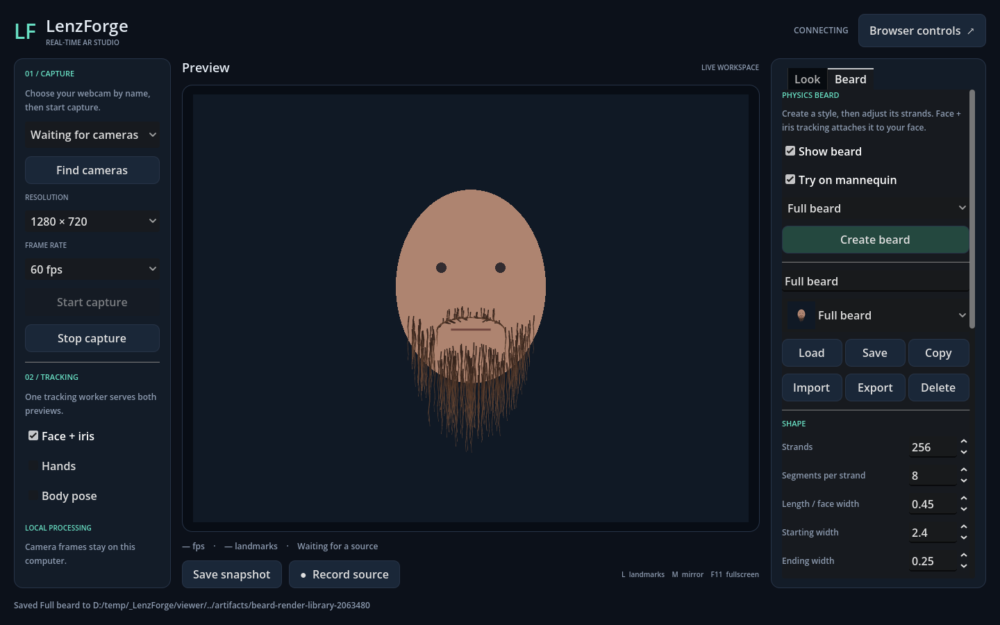

# Physics beard editor

The desktop **Beard** tab creates and edits a beard attached to face landmarks. It includes a native strand solver, tapered colored rendering, an offline mannequin, a saved-model library, and a Blender curve bridge.



## Try it

1. Open **Beard**, select Full beard, Goatee, Mustache, or Sideburns, and click **Create beard**.
2. Check **Try on mannequin** to design without camera capture or a backend. Drag the mannequin to see the strands respond to movement.
3. To use your face, uncheck the mannequin, start your webcam, and keep **Face + iris** enabled. **Show beard** controls visibility. Tracking loss hides the beard and pauses physics; reacquiring a face resumes it.
4. Scroll the right panel to reach shape, physics, and individual strand controls. Turn off landmark dots with **L** for a clearer preview.

The C++ extension must be rebuilt after updating an older checkout: close viewers and run `Setup.ps1 -SkipInstall`. The current working beard and visibility are restored when the desktop closes normally. Use the library to retain several designs.

## Controls

| Control | Behavior |
| --- | --- |
| Strands | 16–1,024 separate simulated hairs; default 256. |
| Segments per strand | 2–16 joints along each hair; default 8. More segments allow finer bends and cost more CPU time. |
| Length / face width | Overall length relative to tracked face width. Chin and mustache regions have different length factors. |
| Starting / ending width | Taper endpoints in pixels at a 300-pixel-wide face; widths follow face scale. Zero ending width gives a pointed tip. |
| Curl / length variation | Rest-shape curl and seeded variation between strands. |
| Root / tip color | RGBA endpoint colors interpolated along the strand. |
| Regrow strands | Generate new roots and length variation with a new seed. Individual overrides remain associated with strand indices. **Create beard** starts a fresh preset. |
| Gravity | Downward acceleration in face widths per second squared. |
| Horizontal wind / wind variation | Horizontal acceleration and time-varying gusts. Positive wind follows camera coordinates, which the mirror option can reflect. |
| Damping | Removes a fraction of velocity each physics step. Higher values settle motion faster. |
| Shape stiffness | Pulls toward the original curled or imported rest shape. Lower values let gravity and wind reshape the beard more. |
| Keep strands out of mouth | Pushes simulated points outside an ellipse following the lips. |
| Reset motion | Returns the strands to their rest shape and clears accumulated velocity. |

Enable **Select strands in preview**, then click a root. The selected strand is highlighted. Its length multiplier, starting/ending widths, curl, and colors can override the global settings. **Hide this strand** sets its length to zero; **Restore strand defaults** removes its overrides. Turn selection off to drag the mannequin again.

## Save and exchange designs

Enter a name and click **Save**. The dropdown lists saved beards with mannequin thumbnails. **Load** opens the selected model, **Save** updates the currently loaded entry, **Copy** creates another entry, and **Delete** removes the selected saved entry after confirmation. Deleting an entry leaves the current working preview available. After restarting, load an existing entry before saving if you want to replace it.

The library is in Godot's `user://beards`, normally `%APPDATA%\Godot\app_userdata\LenzForge Studio\beards` on Windows. Files use generated IDs so names can contain ordinary punctuation. JSON saves use a temporary file followed by replacement. Thumbnails show a neutral mannequin; no live camera image is stored in them.

**Export** writes a versioned `.json` file with settings, per-strand overrides, and neutral curve geometry. **Import** validates and opens one; click Save to add it to the library. File size is limited to 8 MB, strand counts and numeric ranges are bounded, and invalid files leave the current beard unchanged.

### Blender workflow

The optional add-on is [`tools/blender_beard.py`](../tools/blender_beard.py). It has been tested with Blender 5.2.0 LTS.

1. Export a beard from LenzForge.
2. Install the Python file as a Blender add-on, or open it in Blender's Text Editor and choose **Run Script** for that session.
3. Choose **File → Import → LenzForge beard (.json)**. It creates one Curve object containing the individual poly splines.
4. Edit curve points in the local XY plane. Point radii control thickness; the first and last radii become the viewer's starting and ending widths. Keep the strand count/order, keep splines as Poly, and use 2–65 points per strand. Blender can subdivide existing splines for more control.
5. With that object selected, choose **File → Export → LenzForge beard (.json)**, then import the result in LenzForge.

The viewer resamples imported guides to its selected segment count, scales them to the strand's length, and uses them as physics rest shapes. Relative curve bends, length, endpoint widths, existing colors, and hidden strands survive the exchange. Editing an individual strand's **Curl** in LenzForge replaces its imported guide with a procedural curl; **Restore strand defaults** also removes the guide.

Geometry uses one face width as a unit, X right, Y up, Z zero. Root positions are rebound to the same face regions in LenzForge. Blender object transforms, Z depth, intermediate radius changes, materials, and particle hair systems are not imported. Apply desired bends in local XY coordinates; this bridge handles editable poly curves.

## Runtime scope and performance

This is 2D physics over the camera preview. Roots follow face position, scale, roll, and local landmark deformation. There is no 3D head occlusion, hair-to-hair collision, or full skin collision; mouth collision is an ellipse approximation. Extreme profile views may need a future 3D attachment/rendering system.

Physics runs in the C++ GDExtension at a fixed 120 Hz, with at most four catch-up steps. Strand points use contiguous arrays; rest directions are prepared only when a design changes. One instanced GPU batch draws all segments with taper and edge antialiasing. There is no scene node or rigid body per strand. Disabled or untracked beards stop simulation. The camera, shared-memory readers, and inference worker stay independent.

On the development Ryzen 5 5500 / RX 7900 XTX machine, the default 256 × 8 beard averaged **0.67 ms** for physics plus packed upload preparation; 1,024 × 16 averaged **5.42 ms**. Both 20-second webcam runs reported 60 FPS rendering and about 60 FPS capture. These costs exclude landmark attachment, GPU completion, and presentation; see [measurements and limits](PERFORMANCE.md#beard-physics).

Desktop snapshots include the beard and studio controls. Source recordings and browser previews do not include the desktop beard. A composed-video/virtual-camera output remains separate work.

## Validation

`tools/check.py` runs profile/library/native physics checks alongside the existing capture tests. It covers deterministic roots, gravity/wind, pinned roots, segment lengths, mouth collision, bounded catch-up, invalid input, hidden strands, face loss, individual overrides, maximum-size files, imported guides, mirroring, and resizing. Python tests validate the Blender interchange math.

Additional checks requiring a graphics context or Blender:

```powershell
.\buildtools\godot-4.7.2\Godot_v4.7.2-stable_win64_console.exe --path viewer --script res://tests/beard_render.gd --quit-after 600
.\buildtools\python-3.15.0\python.exe -B tools\check_blender.py --blender 'C:/Program Files/Blender Foundation/Blender 5.2/blender.exe'
```

The first checks rendered pixels, visibility, strand selection, control updates, and library thumbnails using a mannequin. The second exports from Godot, edits a real Blender curve, exports it, then runs the returned guide through Godot's native physics. Both write only synthetic artifacts under `artifacts/`. The rendered editor, capture, and performance probes disable settings persistence to preserve the user's working design.
