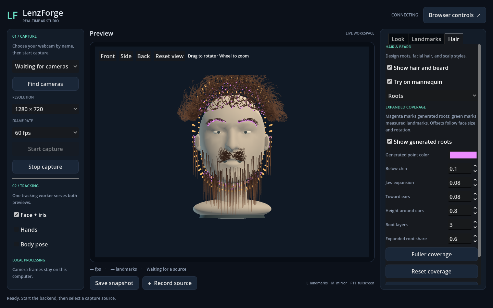
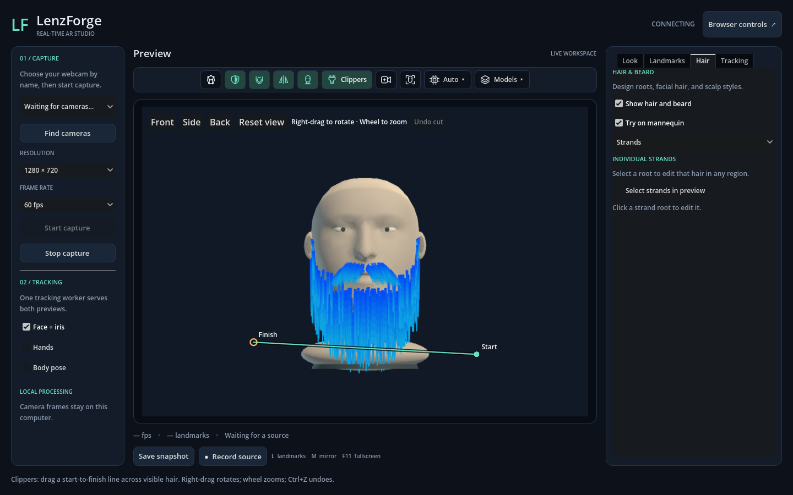
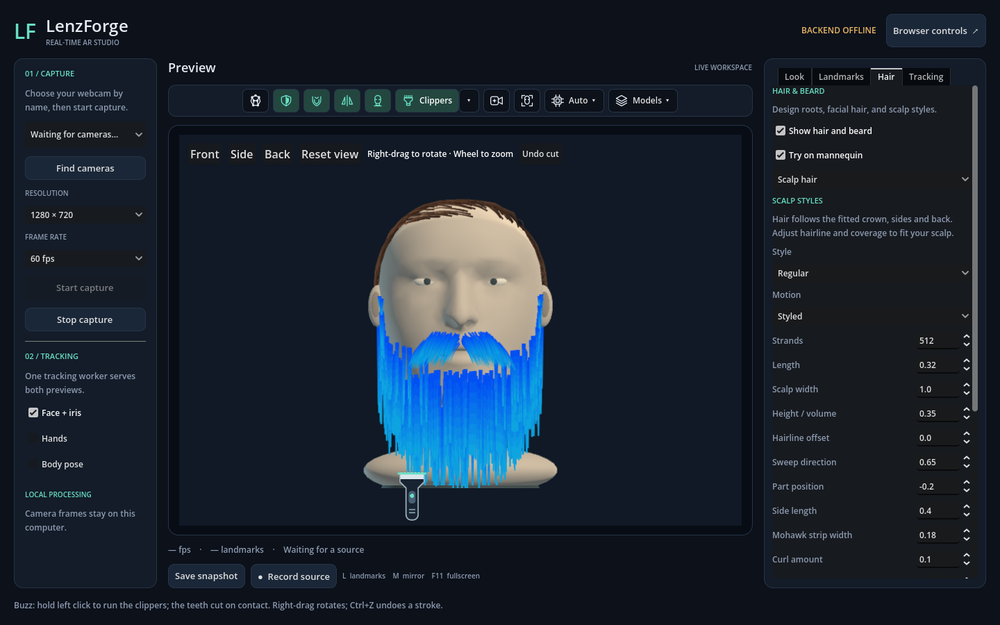
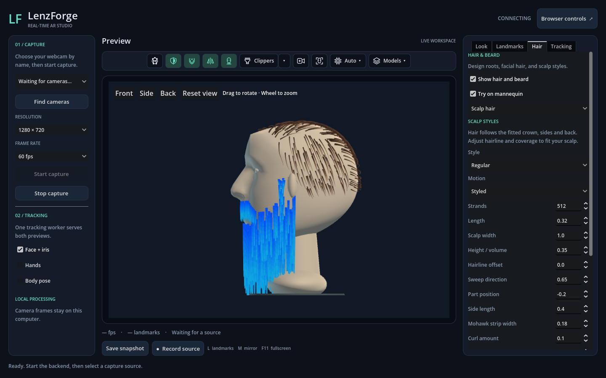
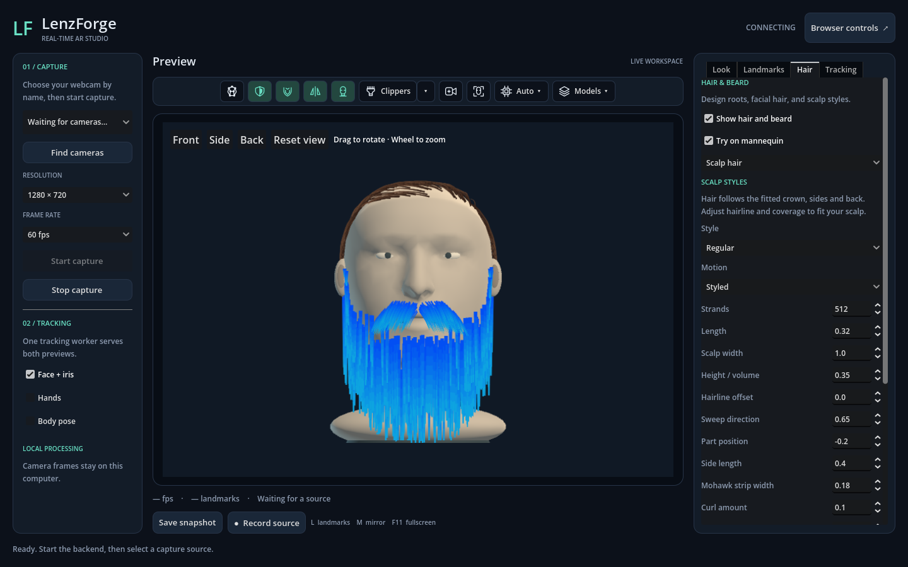
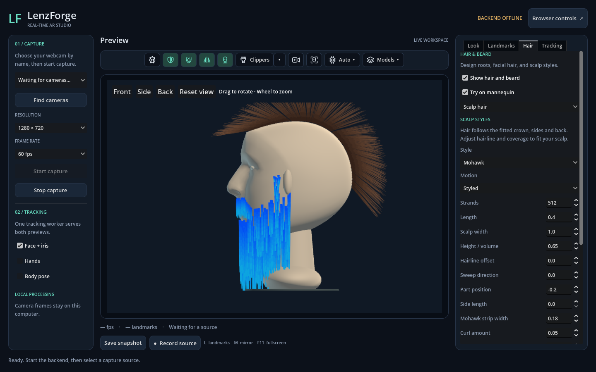
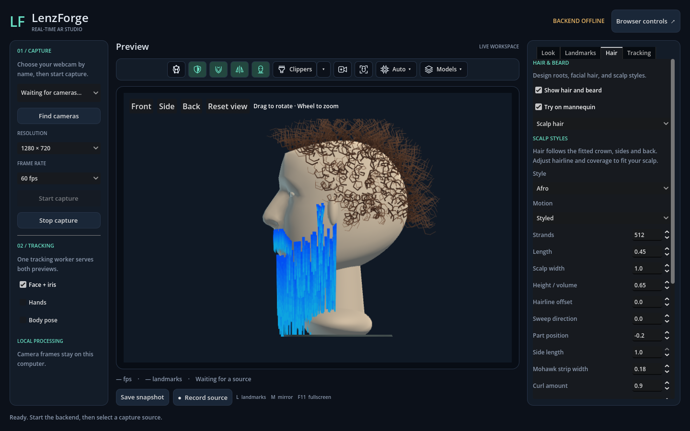

# Hair and beard editor

The desktop **Hair** tab creates beard, mustache, eyebrow, and scalp overlays attached to face landmarks. It includes a native strand solver, tapered colored rendering, an offline mannequin, a saved-look library, and a Blender curve bridge.

The **Full beard** defaults are **1,024 facial strands**, **8 segments per strand**, **0.5 length**, **0.57 curl**, and **0.14 length variation**. Starting/ending widths are **7.4 / 3.05**, with root/tip colors **#0849f4 / #12aadf**. Physics defaults are **12.0 gravity**, **0.0 horizontal wind**, **0.0 wind variation**, and **0.045 damping**.

The default mustache is **Chevron**, using **Styled** motion, **2.0 coverage width**, **0.85 thickness**, **3.0 density**, and root/tip colors **#0645fa / #10acdb**. **Show hair and beard** defaults to on. Eyebrows default to **#14e2f2** and remain disabled; scalp hair remains **None**. Landmark guides and **Show generated roots** default to off. Existing saved looks and personal preferences still restore their own values.



## Try it

1. Open **Hair**. Use the page dropdown to switch between **Beard**, **Roots**, **Root surface**, **Mustache**, **Eyebrows**, **Scalp hair**, **Physics**, **Strands**, and **Library**.
2. Check **Try on mannequin** to design on a shaded 3D head without camera capture or a backend. Drag to rotate through a full turn; use the mouse wheel to zoom. **Front**, **Side**, **Back**, and **Reset view** are above the preview. Double-click also resets the view. Moving the head drives strand motion.
3. On **Beard**, choose Full beard, Goatee, Mustache, or Sideburns and click **Apply beard preset**. On **Scalp hair**, choose Regular, Mohawk, or Afro. Open **Root surface** and click **Extend root coverage** to distribute roots over the shared head. Enable eyebrows on their own page.
4. To use your face, uncheck the mannequin, start your webcam, and keep **Face + iris** enabled. **Show hair and beard** controls the complete overlay. Tracking loss hides it and pauses physics; reacquiring a face resumes it.
5. Enable **Landmarks → Show landmark guides** (or the top toolbar's landmark button) to inspect guide dots. Measured dots also have the **L** toggle, roots have **Hair → Roots → Show generated roots**, and virtual guides have **Landmarks → Show virtual landmarks**. The master guide switch and generated roots start disabled.

Strands hang straight down under gravity by default, even when your head is tilted. Head movement moves the roots while the rest of each strand retains momentum: faster turns produce larger swings. After you stop moving and turn wind off, damping settles the strands downward. **Collide with head surface**, on the **Physics** and **Mustache** pages, keeps the corresponding strands outside the shared face, chin, sides, crown and back of the head. Both switches default on and work with landmark guides or visual occlusion turned off. Hair can still be hidden when it is correctly behind the head.

Live landmarks, the head mask and hair roots now use the exact camera frame that produced the tracking result. Hair updates after the readers, and pinned roots update even between fixed physics steps. This removes mismatched-frame sliding during quick turns on CPU and GPU. Inference still adds capture-to-display delay, and model errors/motion blur can still affect accuracy. With face tracking active, preview FPS follows completed tracking; Auto remains available to select the faster backend. If tracking stalls, old overlays are cleared and raw video resumes.

Strands now occlude other strands using their simulated 3D depth in both previews. The nearest opaque strand wins at each pixel, even where two bent strands cross. Higher beard/mustache roots take precedence only at nearly equal depths; that small tie-breaker remains stable through turns and mirroring. Live **Occlusion** also hides far-side hair behind the fitted head; keep it enabled for realistic side views. The mannequin uses the solid head's depth buffer. Occlusion controls visibility; the independent head-collision settings keep strands outside the surface. This does not add physical strand-to-strand collision.

Opaque strand interiors write GPU depth; tapered edges blend smoothly, and fully transparent hair never blocks other hair. Deliberately translucent colors still use ordinary alpha blending, so exact compositing of multiple translucent strands is not guaranteed.

The C++ extension must be rebuilt after updating an older checkout: close viewers and run `Setup.ps1 -SkipInstall`. The current working beard and visibility are restored when the desktop closes normally. Use the library to retain several designs.

## Clippers

Switch to the **3D mannequin**, then click **Clippers** in the top toolbar. Its adjacent **▾** dropdown selects **Line** or **Buzz**; both controls are greyed out in camera mode. **Line** cuts when you release a drag from Start to Finish and pauses the hair while you aim. **Buzz** shows an image of electric clippers: hold the left mouse button to run them, move the teeth into hair to cut on contact, and release to stop. Hovering never cuts. Small/Medium/Large blade widths are available in the dropdown. Mode and width autosave; the tool starts disarmed after restart.

Right-drag rotates the head, the wheel zooms, and **Esc** stops the current stroke or leaves the tool. **Undo cut** or **Ctrl+Z** restores up to twelve previous cuts; one held Buzz stroke is one undo step, even if it cuts many times. Other grooming edits clear this temporary history. Buzz follows the swept blade path between input samples, so fast mouse moves do not skip intervening strands. It leaves simulation running while you cut.





Each stroke cuts the nearest visible strands it crosses from the current view. Hair hidden by other strands or the solid mannequin stays intact; rotate the head or make another pass to reach it. The root-connected part remains attached, with its own shorter length and the **same segment count**. Cutting across an angled line therefore leaves different strand lengths. The cut tip keeps the width and color at the cut point.

Detached ends retain momentum, fall under their region's gravity/wind/damping, and can collide with the head. They fade and are removed after 2.5 seconds of simulation, with a bounded pool and one render batch. Turning the head does not carry detached hair with it. Changing the groom or leaving the mannequin clears loose pieces immediately.

Cuts autosave as ordinary per-strand length, taper, color and guide overrides. They survive restarts, appear on your live face, and are included in look-library saves and exports. The active tool, loose pieces and undo history are temporary. Changing strand count can remove edits for strands that no longer exist, as with other per-strand editing.

## Hair root surface

All roots now fit the same closed head mesh used by virtual landmarks and occlusion. **Hair → Root surface → Extend root coverage** distributes roots across scalp, chin and sides while preserving hairstyle, colors and strand budget. **Expand root coverage** selects that wider procedural distribution; roots always stay on the shared surface.

**Roots → Use lower virtual landmarks** is enabled by default. It distributes the **Expanded root share** (45% by default) under the chin and around both lower sides, with the remaining beard roots on the measured face. Full beard assigns about a quarter of that expanded share to ear-front sideburns. **Under-jaw / side reach** controls how far backward those roots wrap within the measured ear-side boundary (default 0.35), and **Root layers** distributes them across depth bands. This gives the beard depth at side views without adding strands. The bindings are cached on the shared head triangles, so hidden/disabled guide dots and changing guide density cannot detach the hair. Explicit per-strand landmark attachments take priority.

Automatic beard roots stop at the rear edge defined by the **measured landmarks nearest the ears (234 and 454)**. Virtual chin/jaw roots fill the area in front of this edge; increasing coverage or head depth cannot grow the automatic beard onto the back of the skull. The same cap applies to legacy offsets and sideburn width. Existing looks receive this placement correction without changing their saved colors or forces. Explicit per-strand landmark choices still take priority. Free strand tips can swing under wind/inertia; this boundary controls where hair grows.

**Sideburns in front of ears** defaults on for Full beard and Sideburns. It continues the beard up both sides immediately ahead of the ears, tapering strand length toward the top. **Sideburn rise** defaults to 0.35; **Sideburn wrap width** defaults to 0.06 face widths. Both controls autosave with the look. Roots are fitted to head triangles once when placement changes, then follow measured head motion. They share the existing facial strand budget. Goatee and Mustache do not grow these strips.

Turn off **Use lower virtual landmarks** to use the older chin/jaw/ear offset controls; those controls are disabled while automatic lower coverage is selected. Goatee and Sideburns constrain the automatic distribution to their corresponding lower regions. The head-fit controls deform both placement modes together.

**Scalp coverage**, **Scalp spread**, regional reach, and coverage controls change where roots lie. Fit the head itself with **Landmarks → Visibility → Head depth / Crown height**. The **Show shared landmarks…** button opens its orange guide controls. The separate hair-only grid has been retired; old look settings remain readable as distribution preferences.

The mannequin uses this same mesh and shared triangle bindings, so roots and orange points follow the rendered contour at front, side and rear views. Live capture uses measured face depth to deform the same topology. Unmeasured scalp/back geometry is an estimate, not a reconstruction of the user's head. See [the landmark guide](LANDMARKS.md) for fitting and the common attachment API.

## Expanded roots and regional controls

**Roots** adds generated anchors beyond the measured face outline. Magenta is the default generated-point color; measured landmarks use the existing green overlay. You can change or hide generated-point colors independently. They follow face position, size, and roll. They estimate attachment positions; they do not represent extra detected landmarks.

| Root control | Effect |
| --- | --- |
| Use lower virtual landmarks | Default automatic placement on the lower shared head; preserves the existing strand count. |
| Sideburns in front of ears | Adds a short ascending strip on both sides in automatic placement mode; no extra strands. |
| Sideburn rise / wrap width | Adjusts the upper extent and backward spread of the ear-front strip. |
| Under-jaw / side reach | Backward coverage over the lower head, from 0.05 to 0.70. Available in automatic lower placement mode. |
| Below chin | Extends roots beneath the chin by up to 0.80 face widths. |
| Jaw expansion | Spreads the lower beard outward by up to 0.50 face widths. |
| Toward ears | Extends side roots outward by up to 0.60 face widths. |
| Height around ears | Moves the sideburn coverage from lower cheek toward the upper side of the tracked face. |
| Root layers | 1–6 bands of generated roots across the extension, with small seeded variation. |
| Expanded root share | Fraction of beard roots assigned to the extended regions. Remaining roots retain cheek/chin coverage. |
| Fuller coverage | Enables lower virtual coverage with 0.35 backward reach and a 60% expanded share; increases the facial budget to at least 512 strands. Reset coverage restores automatic lower placement and clears custom offsets while keeping the chosen density. |

**Mustache** provides Natural, Chevron, Handlebar, and Walrus rest shapes. Set coverage width/thickness, density relative to the beard, strand length, lift above the lip, curl, taper, color, and shape hold. Its density redistributes the facial strand budget, so increasing it does not create an unbounded extra simulation. Set **Motion** to Static for a fixed mustache, Styled for a flexible shape, or Free to hang under gravity.

**Mustache → Mustache physics** has independent gravity, horizontal wind, wind variation, damping, and head collision. Its length variation is independent too. Editing the corresponding beard/hair controls no longer changes these mustache settings. Force edits update the native solver in place and preserve momentum. New looks start with gravity 12, wind/variation 0, damping 0.045, collision on, and length variation 0.14. Older looks copy their former shared values once on load, then save the independent values. Beard presets retain the mustache settings. Facial strand allocation and segment quality remain shared performance budgets; appearance and forces are regional.

**Eyebrows** provides Natural, Straight, Arched, and Bushy styles, with 16–256 hairs across both brows. Set coverage width, thickness, arch, lift, growth angle, strand length, taper, color, and motion. Roots follow the tracked eyebrow contours. Static is the default.

**Scalp hair** provides these procedural starting points:

| Style | Shape and useful controls |
| --- | --- |
| Regular | Swept top and shorter sides; sweep direction, part position, side length. |
| Mohawk | Narrow central root strip and raised strands; strip width, length, volume. |
| Afro | Rounded root coverage with coiled outward guides; curl, coil frequency, volume, frizz. |

All scalp styles support 32–768 hairs, scalp width, hairline offset, length, volume, curl, clumping, frizz, length variation, taper, root/tip colors, motion, and shape hold. Selecting a preset applies its shape settings and Styled motion. Density, colors, hairline fitting, and custom per-strand guides remain editable. **None** hides scalp hair while retaining its individual edits. Coil frequency is limited to one coil per four segments to avoid undersampling; more segments allow finer curls at higher cost.

Scalp roots now cover the fitted **crown, temples, sides and back**, with area-weighted distribution across actual head triangles. The hairline stays high at the front and descends around the ears and back. Regular uses curved 3D guides fitted around the surface; Mohawk follows a narrow front-to-back strip; Afro grows outward in three dimensions. **Scalp width** adjusts lateral coverage, **Hairline offset** raises/lowers the boundary, and **Side length** shortens Regular hair at the sides/back. Saved explicit root attachments still take priority. No virtual-guide visibility switch or separate expansion step is needed for scalp coverage. The existing strand budget is spread over this larger area; use count and widths to adjust visible fullness.



The shared head fit remains an anatomical estimate, including when calibrated. These styles follow its shape and the shared head collision settings. Cuts and Blender round-trips preserve spatial guides, including depth.





### Motion modes

- **Free:** no shape spring; gravity, wind, and head-motion inertia determine the fall. Calm strands settle straight down even at a tilted head angle.
- **Styled:** reacts to forces and movement while a shape-hold spring pulls toward the selected or imported guide. Set hold lower for a softer style.
- **Static:** follows face position, scale, and roll without swinging. Gravity and wind do not deform it; integration and constraint work are skipped.

The beard uses **Physics → Preserve styled beard shape** to switch between Free and Styled. Mustache, eyebrows, and scalp have independent motion selectors. The **Physics** page controls beard/brow/scalp forces and collision; **Mustache** controls its own forces and collision. Head collision also applies to static guides. Roots have a small clearance based on strand width; moving strands slide along the skin, and collision takes priority over small residual segment stretch.

## Beard and shared physics controls

| Control | Behavior |
| --- | --- |
| Facial strands | 16–1,024 hairs shared by beard and mustache; default 1,024. Optional brows and scalp have separate budgets; total maximum is 2,048. |
| Segments per strand | 2–16 joints along each hair; default 8. More segments allow finer bends and cost more CPU time. |
| Beard length | Length relative to tracked face width, with region-specific factors. Mustache, brows, and scalp use their own length controls. |
| Starting / ending width | Taper endpoints in pixels at a 300-pixel-wide face; widths follow face scale. Zero ending width gives a pointed tip. |
| Curl / length variation | Rest-shape curl and seeded variation between strands. |
| Root / tip color | RGBA endpoint colors interpolated along the strand. |
| Regrow roots | Generate new roots and length variation with a new seed. Individual overrides remain associated with stable strand IDs. **Apply beard preset** resets facial edits and keeps the scalp/brow setup. |
| Gravity | Downward acceleration in face widths per second squared, independent of head tilt. Higher gravity speeds the fall and resists wind more strongly. Zero disables gravitational acceleration. |
| Horizontal wind / wind variation | Horizontal acceleration and time-varying gusts. Gusts apply only when wind is nonzero, so zero wind is calm. Positive wind follows camera coordinates, which the mirror option can reflect. |
| Damping | Removes a fraction of velocity each physics step; default 0.045. It controls how long motion persists. Very high damping can make falling sluggish. |
| Preserve styled beard shape | Off by default, including for files saved before this option existed. Enable it to hold beard curls or an imported rest shape against gravity. |
| Beard shape stiffness | Used only with **Preserve styled beard shape**. Pulls toward the original curled or imported shape. |
| Collide with head surface | Keeps beard/brow/scalp strands outside the shared 3D head, including the space between strand joints. Mustache has its own collision toggle. Both default on and work independently of visual occlusion. |
| Reset motion | Clears velocity and hangs the strands downward, or restores their rest shape when **Preserve styled shape** is enabled. |

On **Strands**, enable **Select strands in preview**, then click a root in any region. **Attach root to landmark** places it on any measured or virtual guide; this binding autosaves and survives guide-density changes. **Restore root placement** clears only that binding. The selected strand is highlighted. Its length multiplier, starting/ending widths, curl, and colors can override its region settings. **Hide this strand** sets its length to zero; **Restore strand defaults** removes its overrides. Turn selection off to drag the mannequin again. Facial IDs retain their original numeric form; brows use `brow:N` and scalp uses `hair:N`. Hiding an optional region keeps its edits. Reducing a region's strand count removes edits outside the new count.

## Save and exchange designs

Open **Library**, enter a name, and click **Save**. Each look includes all regions, root offsets, physics settings, colors, and individual edits. The dropdown lists saved looks with mannequin thumbnails. **Load** opens the selected model, **Save** updates the currently loaded entry, **Copy** creates another entry, and **Delete** removes the selected entry after confirmation. Deleting an entry leaves the current working preview available. The working look and loaded library entry now autosave independently of named presets and restore after a restart; **Save** can update the same entry. See [automatic settings](SETTINGS.md).

The library is in Godot's `user://beards`, normally `%APPDATA%\Godot\app_userdata\LenzForge Studio\beards` on Windows. Files use generated IDs so names can contain ordinary punctuation. JSON saves use a temporary file followed by replacement. Thumbnails show a neutral mannequin; no live camera image is stored in them.

**Export** writes a version 2 `.json` file with settings, per-strand overrides, and neutral curve geometry. Version 1 beard files still load, with optional scalp/brow regions disabled. **Import** validates and opens a file; click Save to add it to the library. File size is limited to 16 MB, strand counts and numeric ranges are bounded, and invalid files leave the current look unchanged. The maximum combined export with 65-point custom guides was tested at about 10.2 MB.

### Blender workflow

The optional add-on is [`tools/blender_beard.py`](../tools/blender_beard.py). It has been tested with Blender 5.2.0 LTS.

1. Export a complete look from **Hair → Library** in LenzForge.
2. Install the Python file as a Blender add-on, or open it in Blender's Text Editor and choose **Run Script** for that session.
3. Choose **File → Import → LenzForge beard (.json)**. It creates one Curve object containing the individual poly splines.
4. Edit curve points in the local XY plane. Point radii control thickness; the first and last radii become the viewer's starting and ending widths. Keep the strand count/order, keep splines as Poly, and use 2–65 points per strand. Blender can subdivide existing splines for more control.
5. With that object selected, choose **File → Export → LenzForge beard (.json)**, then import the result in LenzForge.

The viewer resamples imported guides to its selected segment count, scales them to the strand's length, and stores them as physics rest shapes. Use Styled or Static motion to retain regional guides; enable **Preserve styled beard shape** for beard guides. Relative curve bends, length, endpoint widths, existing colors, hidden strands, stable region IDs, and motion settings survive the exchange. Editing an individual strand's **Curl** in LenzForge replaces its imported guide with a procedural curl; **Restore strand defaults** also removes the guide. Add-on version 2 supports both old beard files and combined looks.

Geometry uses one face width as a unit, X right, Y up, Z zero. Root positions are rebound to the same face regions in LenzForge. Blender object transforms, Z depth, intermediate radius changes, materials, and particle hair systems are not imported. Apply desired bends in local XY coordinates; this bridge handles editable poly curves.

## Runtime scope and performance

Live-camera hair uses a transparent, depth-tested 3D layer composited over the video. Virtual attachment uses relative depth to project an estimated head during turns, but the scalp/ear points are not newly measured anatomy. Existing real hair is not removed. The shared head-depth map clips far-side roots and strand fragments; turn it off under Landmarks → Visibility to inspect hidden guides.

The live preview and mannequin use native 3D strand dynamics. Each segment carries its own endpoint depths into rendering, so collision can move hair around the head without flattening it to the root depth. The collider follows the shared head mesh, uses a directional triangle lookup for point contacts, and sweeps links to prevent intersections between joints. Head updates refit the lookup; there are no per-strand scene nodes, rigid bodies or GPU readbacks. The solid outer envelope closes small tracking degeneracies. Live scalp/back shape is still estimated; this does not add hair-to-hair, shoulder, hand or room-object collision. Blender exports retain editable rest guides with all three coordinates at the shared 3D roots, rather than exporting the current simulated pose.

The mannequin builds its mesh only when first opened. Root fitting is cached between setting changes, and hair uses one instanced batch with the native packed buffer uploaded directly to a bounded texture. Both previews share that uploader and spatial shader. The live layer uses GPU depth and color passes, followed by a single video-overlay composite; there is no CPU sorting during movement or GPU readback. The viewports follow the displayed preview resolution, capped at 720 pixels high, and stop rendering when inactive. With hair disabled, it renders only when the pose, fitting, visibility, or size changes. Library thumbnails use the same head at thumbnail resolution.

Physics runs in the C++ GDExtension at a fixed 120 Hz, with at most four catch-up steps. Roots interpolate between tracking updates; free points retain world-space momentum. Neighboring free points share tension corrections, followed by a length correction pass. Strand points use contiguous arrays; rest directions are prepared only when a design changes. One instanced GPU batch draws all segments with taper and edge antialiasing. There is no scene node or rigid body per strand. Disabled or untracked beards stop simulation. The camera, shared-memory readers, and inference worker stay independent.

On the development Ryzen 5 5500 / RX 7900 XTX machine, the corrected free-hanging solver at the then-default 256 × 8 size averaged **0.57 ms** for physics plus packed upload preparation. The 20-second webcam run reported 60 FPS rendering and about 60 FPS capture. These costs exclude landmark attachment, GPU completion, and presentation; see [measurements and limits](PERFORMANCE.md#beard-physics), including the earlier solver's maximum-density run.

The expanded 864 × 8 combined look averaged **2.77 ms including root attachment, generated markers, physics, and upload preparation** in an offline animated-face test. The maximum 2,048 × 16 setting averaged 10.76 ms with markers. These synthetic timings exclude camera/inference and GPU completion; see the [combined measurements](PERFORMANCE.md#combined-hair-regions). All regions share one native solver and one hair draw batch.

## Design references

The presets translate recognizable styling features into inexpensive 2D guides; they are not reconstructions of particular people's hair. The Regular preset uses a swept part and shorter sides informed by [Wahl's side-part guide](https://wahlusa.com/how-to/haircutting/mens-haircuts/side-part). The raised Mohawk strip follows the central, upward styling idea illustrated in [Wahl's home haircutting guide](https://wahlusa.com/media/wahl-home-haircutting.pdf). The rounded Afro silhouette and coil controls draw on [Afrocenchix's discussion of natural Afro styles](https://afrocenchix.com/blogs/afrohair/love-your-fro-celebrating-afro-hair-on-world-afro-day).

Guide-based clumping and seeded strand variation are informed by Blender's [Clump Hair Curves](https://docs.blender.org/manual/en/4.4/modeling/geometry_nodes/hair/guides/clump_hair_curves.html) and [Frizz Hair Curves](https://docs.blender.org/manual/en/4.0/modeling/geometry_nodes/hair/deformation/frizz_hair_curves.html) controls. The root system uses the existing [MediaPipe Face Landmarker](https://developers.google.com/edge/mediapipe/solutions/vision/face_landmarker); no extra detection model is needed.

Desktop snapshots include the beard and studio controls. Source recordings and browser previews do not include the desktop beard. A composed-video/virtual-camera output remains separate work.

## Validation

`tools/check.py` runs profile/library/native physics checks alongside the existing capture tests. It covers deterministic roots, gravity/wind, pinned roots, segment lengths, head and legacy mouth collision, bounded catch-up, invalid input, hidden strands, face loss, individual overrides, maximum-size files, imported guides, mirroring, and resizing. Dynamics regressions compare gravity/wind strengths, slow/fast head turns, calm settling at a tilted head angle, and equivalent motion delivered at 30/60/120 Hz. The head-collision regression independently samples complete links against a moving solid box in Free/Styled/Static modes and against the shared head at front, side and rear poses; it also checks root pinning, disabled collision, invalid mesh indices and segment depth output. Python tests validate the Blender interchange math.

Combined-groom regressions cover extended root positions, rotation/scale behavior, mustache coverage, Static/Free region motion, old-file loading, stable region edits, all three scalp presets, maximum combined allocation/export, and native option validation.

Legacy-distribution tests retain coverage of crown/chin/side settings and saved looks. Shared-surface tests verify actual triangle contact, common hair/object bindings, stable IDs, full-turn projection, independent guide/hair budgets, save/load/export, and clearing on face loss. Rendered tests exercise the actual fitting button, marker color, shared controls, and studio depth forwarding at 1440×900 and 1024×720. The Blender check preserves virtual-head fitting with its returned curves.

Additional checks requiring a graphics context or Blender:

```powershell
.\buildtools\godot-4.7.2\Godot_v4.7.2-stable_win64_console.exe --path viewer --script res://tests/beard_render.gd --quit-after 600
.\buildtools\godot-4.7.2\Godot_v4.7.2-stable_win64_console.exe --path viewer --resolution 1440x900 --script res://tests/groom_render.gd
.\buildtools\godot-4.7.2\Godot_v4.7.2-stable_win64_console.exe --path viewer --resolution 1440x900 --script res://tests/virtual_head_render.gd
.\buildtools\python-3.15.0\python.exe -B tools\check_blender.py --blender 'C:/Program Files/Blender Foundation/Blender 5.2/blender.exe'
```

The rendered checks exercise pixels, generated-marker colors, presets, visibility, strand selection, controls, and library thumbnails using a mannequin. `viewer/tests/mannequin_probe.gd` is part of `tools/check.py`; it verifies true 3D projection, profile/rear attachment, orbit, zoom, mirroring, and the return to live rendering. Run `viewer/tests/mannequin_render.gd` with the same Godot command pattern above to check front/side/rear screenshots, depth occlusion, actual 3D hair pixels, maximum GPU allocation, and idle viewport shutdown. The Blender check exports all regions from Godot, edits real curves, exports them, then runs the returned guides through native physics. Checks write synthetic artifacts under `artifacts/`. The rendered editor, capture, and performance probes disable settings persistence to preserve the user's working design.
