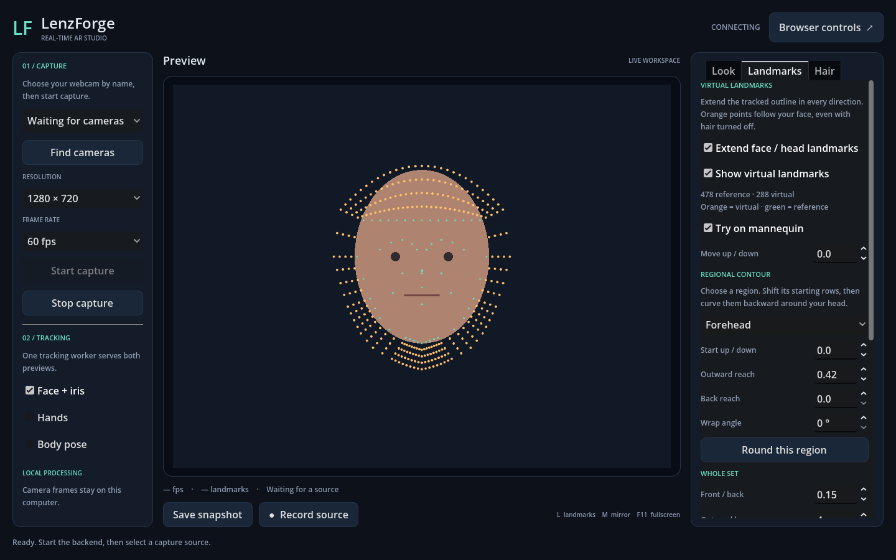
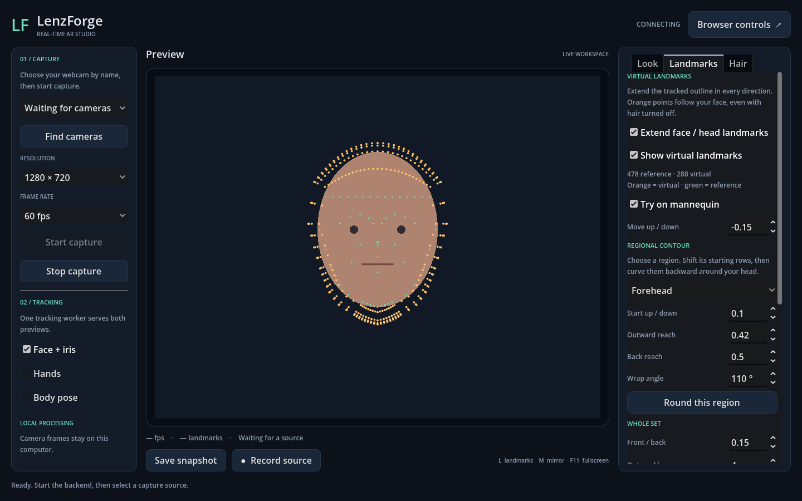

# Virtual face and head landmarks

Open the desktop **Landmarks** tab, between **Look** and **Hair**. Virtual points are enabled by default and appear in orange around the complete face outline. They work with **Show hair and beard** turned off.

Start the camera with **Face + iris** enabled, or select **Try on mannequin** in this tab. The status reports the measured and virtual point counts and explains when it is waiting for a face. On the mannequin, the synthetic inputs are labeled “reference.”

| Control | Effect |
| --- | --- |
| Extend face / head landmarks | Enable or disable the independent virtual reference data. |
| Show virtual landmarks | Show or hide the orange dots while retaining active reference data. |
| Move up / down | Move the whole virtual set vertically: negative goes up, positive goes down, and zero restores the original placement. Follows head orientation and preserves the shape and density of the rings. |
| Regional contour | Choose **Forehead**, **Left side**, **Right side**, or **Chin** to shape its rows independently. |
| Start up / down | Move the selected region's starting rows vertically. Positive lowers them, negative raises them. |
| Start in / out (sides) | Shift the selected side's starting rows inward toward the face with a negative value, or outward with a positive value. |
| Outward reach | Height above the forehead, distance below the chin, or width outside the selected side. Left/right refer to the unmirrored image. |
| Back reach | Additional distance behind the selected region. Adds to the whole-set **Front / back** value. |
| Wrap angle | **0°** extends straight; **90°** curves backward along a quarter ellipse; angles above **90°** turn inward after reaching the crown or side. Maximum **180°** returns toward the starting height/width behind the head. |
| Round this region | Apply a starting contour with **110°** wrap and **0.5** back reach (**0.3** for the chin). Preserves starting position, outward reach, and whole-set movement. |
| Front / back | Negative values extend toward the front; positive values extend behind the face. Turn or tilt the head to see the depth offset in the preview. |
| Outward layers | Number of progressively farther rings, from 1 to 12. |
| Points around face | Samples per ring, from 36 to 144. |
| Point size / color | Appearance of virtual dots, separate from measured points and hair roots. |
| Reset extensions | Restore the visible, enabled default fit. |

Reach and position values use face widths. For example, **Chin → Outward reach = 0.2** with zero wrap extends the outer lower row one fifth of the face width below the chin. The intermediate rows sample the contour from its starting position toward the back. Default density is **72 × 4 = 288** points; the maximum is **144 × 12 = 1,728**. Changing density does not add hair strands or tracking work in the backend.

Use **Move up / down = -0.1** to lift every virtual point by one tenth of a face width, or **0.1** to lower them. This offset saves with the extension settings and follows head turns and tilts. **Reset extensions** returns it to zero.

## Fit a contour around your head

The **Move up / down** control still moves the whole set. Use **Regional contour** for local fitting:

1. Choose **Forehead**, set **Start up / down** to **0.1** to lower its starting rows, and click **Round this region**. Adjust **Outward reach** to fit the crown and **Back reach** to carry the rows farther behind it. A wrap angle above 90° lets the rows turn downward again behind the crown.
2. Choose either side. Try **Start in / out = -0.08** to tuck its starting rows toward the face, then **Round this region** to curve toward the back of the head. **Start up / down** adjusts the height of that side around the ear.
3. Choose **Chin**. A negative **Start up / down** raises its starting rows; **Outward reach**, **Back reach**, and **Wrap angle** fit a curve underneath and behind the chin.

Turn or tilt your head to judge backward reach: depth projects onto the preview during rotation. Neighboring regions blend through the temples and jaw. These are adjustable estimated contours; no head scan or automatic skull fitting is performed. Existing saved settings retain their previous shape until a regional contour is adjusted. All controls save independently of hairstyles.

The lower part of this tab contains the measured-landmark visibility, size, and color controls. **L** toggles measured dots only. General virtual points, measured points, and hair visibility are independent. Extension settings persist across normal viewer restarts, separately from saved hairstyles. Existing hair-root fitting remains under **Hair → Root surface**.

The outline follows MediaPipe's [face-oval connections](https://github.com/google-ai-edge/mediapipe/blob/master/mediapipe/tasks/python/vision/face_landmarker.py). Each virtual point interpolates between adjacent tracked outline landmarks, then adds an offset in a head-relative frame. Existing relative depth drives yaw and pitch; the same frame follows roll, translation, and scale. These are estimated references, not newly measured anatomy, and the preview has no full-head depth occlusion. Invalid or lost tracking clears the virtual data instead of leaving floating points behind.

For other overlays, `viewer/tracking/face_extensions.gd` exposes `ids` and `points` separately from the measured 478-point array. Positions are in source-image pixels before mirroring/letterboxing. IDs use `extension:<ring>:<column>` and remain stable during movement and extent changes; density changes alter the sampling layout. Topology, elliptical contour profiles, and blended offsets are rebuilt only when fitting changes. Each tracking result projects the same packed arrays once; visible dots use one instanced batch. No hair simulation or additional model is needed.
