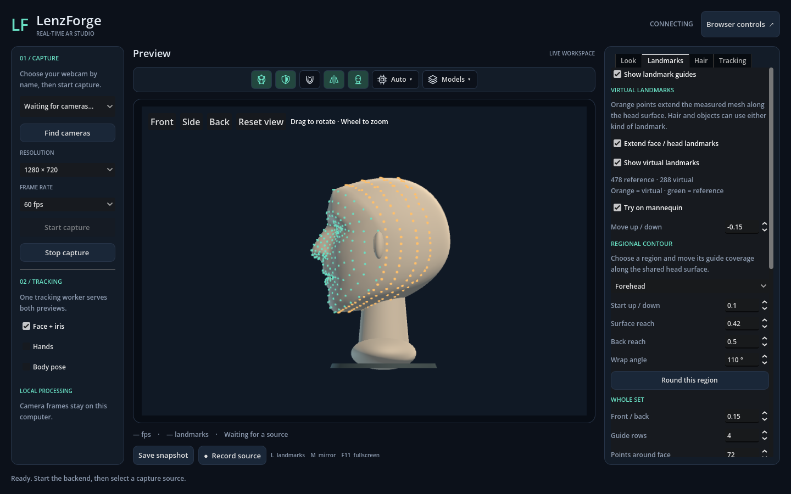

# Shared face and head landmarks

Open **Landmarks** for orange virtual points around the scalp, sides, and underside of the chin. They work with hair turned off. Green points retain the original measured/reference IDs. Both kinds now use the same attachment API and head geometry.

## Contours and controls

Virtual points are fitted to triangles on a closed head mesh, rather than floating offsets. The mannequin renders that exact mesh. Live capture deforms the same topology using measured face coordinates and relative depth. Hair roots and the live occlusion depth map use it too.

- **Head depth** and **Crown height**, under **Landmarks → Visibility**, change the shared head shape, including the mannequin, hair attachment, and occlusion.
- **Move up / down** shifts guide coverage along the skin. **Regional contour** adjusts forehead, left/right side, and chin coverage separately. Start position, reach, and wrap controls choose locations on the surface; they cannot lift guides off it.
- **Guide rows** and **Points around face** change visible sampling density: 72 × 4 = 288 by default, at most 144 × 12 = 1,728. They do not add inference or hair strands.
- **Show virtual landmarks** hides the orange guides. The toolbar's landmarks icon hides every guide group. Neither switch detaches placed items.
- **Extend face / head landmarks** disables this displayed guide set. Existing saved attachments still resolve their surface locations.
- **Reset extensions** restores the established coverage defaults. Existing stored control values load, but their locations are now constrained to the skin; an old floating fit is intentionally corrected.

The previous up/down, regional reach, wrap, and density preferences remain saved automatically. Up/down now follows the surface instead of translating a detached shell. Different settings can converge on the same location at the head's limits.

Start capture with **Face + iris**, or choose **Try on mannequin**. Drag the 3D head, scroll to zoom, and use **Front / Side / Back / Reset view** to inspect the fit. Hidden points remain part of the reference count.

The scalp and back of a real head are estimated from the visible face, not newly measured anatomy. Adjust head depth/crown to improve that estimate. Headphones, hands, and room objects are not part of this surface. The mannequin fit is exact to its mesh; a live fit is not a head scan.

## Attach hair

Open **Hair → Strands**, enable selection, and click a strand root. **Attach root to landmark** lists all 478 measured IDs and the current virtual guide locations. Both use the same root position and depth as the corresponding landmark. **Restore root placement** returns that strand to its procedural placement.

Attachments autosave and are included in saved/exported looks. Their locations remain stable when guide density, coverage, or visibility changes. To move an existing attachment to a different location, choose another landmark. Changes to the shared head shape deform all attachments with the surface.

**Hair → Root surface** distributes procedural roots over the same surface. There is no second orange hair-only grid. Magenta dots still represent individual generated hair roots and have their own display switch.

## Attachment API

`tracking/head_surface.gd` exposes:

- `face:<index>` for original IDs 0–477; measured coordinates are preserved.
- `virtual:<triangle>:<weight-a>:<weight-b>` for stable surface locations. Integer barycentric weights use millionths; the third weight is the remainder. These IDs are independent of the displayed guide layout.
- `binding(id)` returns packed triangle indices/weights, usable for batched attachments.
- `sample(bindings)` evaluates packed bindings in native code.
- `resolve(id)` returns position, outward normal, an orthonormal transform, and an `estimated` flag, or an empty dictionary if unavailable.

Live positions use camera pixels before mirroring/letterboxing: X right, Y down, Z away from the camera, with all three axes in pixel units. The mannequin's local surface uses canonical model units with those same axis directions. Convert Y/Z signs when parenting objects beneath its Godot 3D pivot.

`tracking/landmark_attachment.gd` is a reusable Node3D attachment for an object or effect. Put geometry beneath it, assign a surface and `landmark_id`, and set `surface_transform` to the destination coordinate system. Optional `normal_offset` lifts the object along the skin normal. It updates on new surface data, hides on tracking loss, and uses the same resolver for either landmark type. A 3D child uses its viewport's depth buffer; a custom live 2D renderer must pass the resolved depth to the existing occlusion shader. This is an attachment component, not a general accessory-library UI.

## Performance and validation

The head has fixed topology: 478 measured/reference vertices plus 20 × 36 closure vertices (1,198 total; iris vertices are attachment references rather than face triangles). It is built once per tracking result and shared by overlays. Native nearest-triangle fitting uses a bounding-volume tree and runs only when placement changes; animation uses linear-time packed barycentric sampling. Force/color changes reuse hair bindings; force-only changes also bypass strand/rest-guide rebuilding. Visible markers and hair remain instanced batches.

Tests cover actual triangle contact, measured ID preservation, virtual/hair/object equality, rotations through profile and rear views, head-shape deformation, hidden guides, density changes, malformed IDs, tracking loss, save/load and process restart. See [performance results](PERFORMANCE.md#shared-head-surface) for the before/after CPU benchmark.
